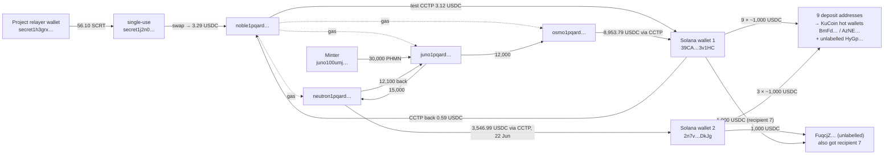
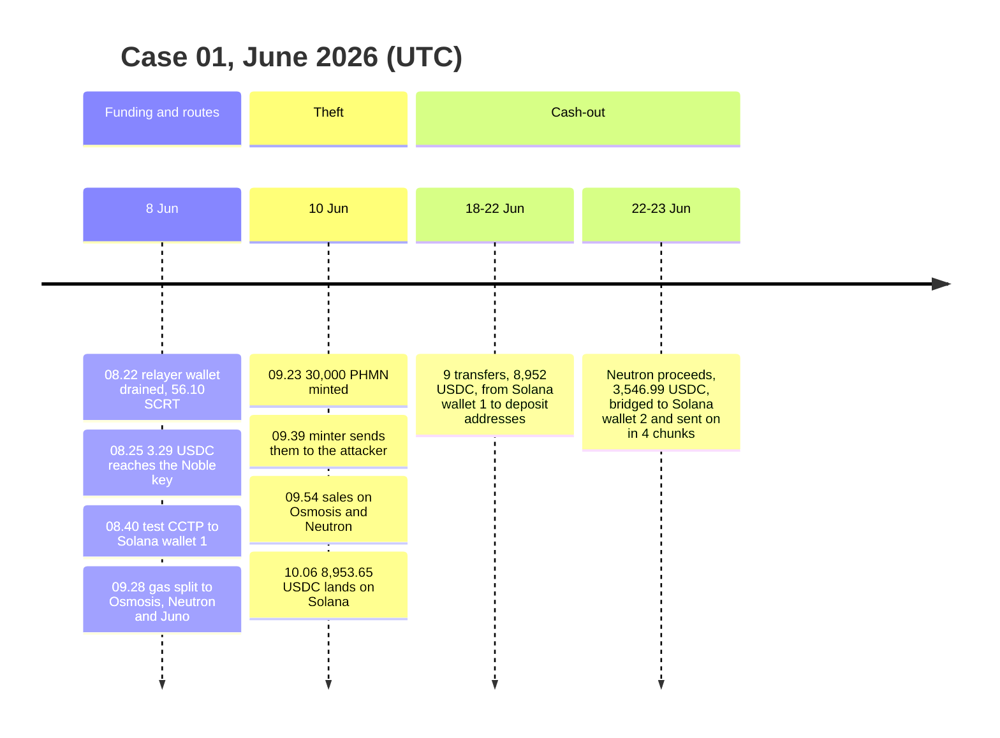

# Case 01: Unauthorized token mint on a Cosmos project (cross-chain tracing and server forensics)

> **Anonymization.** Off-chain identifiers (IP addresses, SSH key fingerprints, key comments, hostnames, names of people and companies) are replaced with labels. On-chain data is public and given in full, so every step can be verified independently.
>
> **Reproducibility.** Every number in this document is recomputed from raw chain data by `python cases/01-unauthorized-mint-juno/checks.py` (37 checks, IDs `C1-xx` are cited inline). Raw responses are in `data/cache/`, pinned by `data/cache/MANIFEST.sha256`, so the checks also run offline. See [reports/verification.md](reports/verification.md) for the full table and [reports/risk.md](reports/risk.md) for the address risk scoring. One exception: Osmosis-side transactions are pruned on public nodes; they are corroborated by the matching Juno send and Solana receive transactions.

## TL;DR

In June 2026 an attacker who had access to two of a project's servers carried out the attack in three stages.

1. **Funding (8 June).** The attacker drained the project's own IBC relayer wallet on Secret Network to pay for the operation, and staged gas and bridge routes across five chains.
2. **Theft (10 June).** Using the minter key held on a second server, the attacker minted 30,000 PHMN (cw20 on Juno). Within 45 minutes the attacker liquidated about half of it on Osmosis and Neutron for ~12,500 USDC and bridged the proceeds to Solana via Circle CCTP.
3. **Cash-out (18-23 June).** On Solana the attacker split the funds into ~1,000 USDC chunks sent to deposit-style addresses. Eight of nine were swept within minutes into three hot wallets. Two of them, and one of the deposit addresses, carry public KuCoin labels on Solscan, so the cash-out went through KuCoin. The Neutron proceeds followed the same route: three of the four recipients swept to the same KuCoin hot wallet within a minute.

I reconstructed the full flow, from the very first funding transaction to the cash-out addresses, and correlated the attack day second by second with the server's SSH sessions and file artifacts. The result was a tiered evidence package for law enforcement that keeps proven facts separate from suspicion.

## Case card

| | |
|---|---|
| Dates | 8 June 2026 (preparation), 10 June (theft), 18-23 June (cash-out) |
| Chains | Secret → Osmosis → Noble → Solana (preparation); Juno → Osmosis / Neutron → Noble → Solana (theft) |
| Assets | PHMN, CosmWasm cw20 on Juno, contract `juno1rws84uz7969aaa7pej303udhlkt3j9ca0l3egpcae98jwak9quzq8szn2l`; USDC on Noble and Solana |
| Loss | 30,000 PHMN minted without authorization; 14,900 PHMN sold for 12,500.78 USDC (C1-14) |
| Outcome | Liquidity pulled within minutes; 15,100 PHMN stranded on the attacker's Juno address; token migrated with the attacker excluded; at least 8,498 USDC traced to KuCoin-labelled wallets, nothing frozen |
| My role | Lead investigator for the client: on-chain tracing, server-log correlation, evidence package |
| Checks | 37 passed, see [reports/verification.md](reports/verification.md) |

## Addresses

| Role | Address |
|---|---|
| Attacker (Juno) | `juno1pqardc39d558mr58nx5m2wgmy448pv94ehdea0` |
| Attacker (Osmosis), same key | `osmo1pqardc39d558mr58nx5m2wgmy448pv9487ajvp` |
| Attacker (Neutron), same key | `neutron1pqardc39d558mr58nx5m2wgmy448pv94t68qq5` |
| Attacker (Noble), same key | `noble1pqardc39d558mr58nx5m2wgmy448pv948xm2za` |
| Attacker Solana wallet #1 / its USDC token account | `39CAqAK85xu24YbTw7LbqnphG1QqReL4PHkcmTX3v1HC` / `AhT5WaWAAoMF48nPssaSFEoygCfsq1N2qq7BTUJqEer` |
| Attacker Solana wallet #2 / its USDC token account | `2n7v9L79nVun7LXVMnvzBF54zktw36BjRD4qbeWfDkJg` / `4w4A2J2CDaVxa6X9RExY3Ty2rFL6CiaETT4KJVNna1hy` |
| Single-use intermediary (Secret) | `secret1j2n0znmwyy95jc8auvdr7ydk05ff97sgd8t7rn` |
| Project Hermes relayer wallet (Secret), victim | `secret1h3grxcfts9uc8lvu9vclhahus2npk24pg0jz5k` |
| PHMN minter (Juno), compromised | `juno100umj2mnu0u6ujf37c9a3xfy9gl53hu9ekxyyw` |
| Skip IBC transfer adapter (infrastructure) | `osmo1m8wg4vxkefhs374qxmmqpyusgz289wmulex5qdwpfx7jnrxzer5s9cv83q` |
| Noble Orbiter CCTP relayer on Solana (infrastructure) | `6MxMEeH2MQTjk7Cd4JDbJSnTvtpoKJuv374KpQYKJ3Rv` |

## My role

I was the lead investigator and ran the investigation end to end. My part:

- Analysed the server logs and correlated them with on-chain activity.
- Traced the full transfer chain across all six chains.
- Uncovered the funding path through the project's Secret Network relayer.
- Developed the primary suspect hypothesis.

Other team members then compiled my findings into the formal evidence package. The verification toolkit in this repository (`tools/`, `risk/` and each case's `checks.py`) is my own follow-up work.

## Objectives

1. Trace where the minted tokens and their proceeds went, and identify freeze or recovery points.
2. Establish how the mint was executed and which access sessions overlap the incident.
3. Produce an evidence package for law enforcement that does not overstate attribution.

## Background: what the attacker had access to

- **The client** was a Cosmos validator operator that ran the PHMN project's infrastructure.
- **Two machines were compromised:**
  - the server holding the PHMN minter key and the airdrop ("stakedrop") tooling;
  - the machine running the project's Hermes IBC relayer on Secret Network.
- **The minter key was a hot key** on a shared operations account, and command auditing was disabled on that server (see Limitations).

## Methodology and tools

**On-chain** (implemented in `tools/`)
- **Raw transaction data from archive REST nodes**, found through the cosmos.directory chain registry (`tools/net.py` tries known archive nodes first, then every registry endpoint). An internal review had concluded that public endpoints could not run event searches; going through the registry's full endpoint lists turned up archive nodes that could. Further sources: Solana JSON-RPC (`tools/solana_util.py`) and block explorers (Mintscan, ping.pub, Solscan).
- **Decoding cross-chain plumbing** (`tools/cctp.py`):
  - IBC packets and ICS-20 / cw20-ICS20 transfers;
  - Skip / Squid `swap_and_action` memos;
  - Noble Orbiter forwarding memos;
  - raw Circle CCTP messages: source and destination domain, `mint_recipient`, and `messageSender`. The `messageSender` field identifies who burned USDC on the other chain.
- **Same-key clustering** (`tools/bech32.py`): an identical 20-byte account payload across Cosmos chains proves common control (C1-01). Contracts and module accounts (32-byte payloads) are excluded from this inference.
- **Exact amount reconciliation** (`checks.py`): every inflow to the preparation wallets is matched to the outflows plus fees, down to the micro-unit.
- **Infrastructure vs. owner:** router contracts and adapters that appear as IBC packet senders, the CCTP relayer, and gas-sponsorship fee collectors are classified as infrastructure, not as linked wallets.
- **Noise filtering:** dust transfers from look-alike vanity addresses (address-poisoning bots) are identified and excluded.
- **Risk scoring** (`risk/model.py`): transparent rule-based scoring of every address in the incident graph; see the section below.

**Server (read-only collection)**
- Sources: `auth.log`, `last -aiF`, `authorized_keys` inventories (current and backup), file metadata (modification and birth/change times), and shell history.
- Chain of custody: the raw log archive was preserved, not published, and hashed with SHA-256.

**Correlation and monitoring**
- A single UTC timeline that merges on-chain events, SSH sessions and file timestamps.
- A watcher on the Solana destination addresses that alerts on new transactions.

## How it unfolded

Short labels in the diagrams; full addresses are in the Addresses table. The complete graph with every scored address is in [reports/graph.md](reports/graph.md).

### 1. Funding: the project's own IBC relayer wallet was drained (8 June, UTC)

| Time | Event | Tx |
|---|---|---|
| 08:22:59 | The project's Hermes relayer wallet `secret1h3grxcfts9uc8lvu9vclhahus2npk24pg0jz5k` sends 56.102115 SCRT to a fresh address `secret1j2n0znmwyy95jc8auvdr7ydk05ff97sgd8t7rn` (C1-02). The relayer account had already signed 29,149 transactions (C1-02b); it has signed none since and its balance is now 0. | `344DDD42B2C83977AFB746E1EF5CF296C1E002A7FF702093937F6618EC09E016` |
| 08:24:45 | `secret1j2n0znmwyy95jc8auvdr7ydk05ff97sgd8t7rn` sends 56.097608 SCRT through IBC to an Osmosis swap contract, with the post-swap destination set to `noble1pqardc39d558mr58nx5m2wgmy448pv948xm2za` (C1-03b, C1-03c). This is the address's only outgoing transaction: it is a single-use intermediary (one inflow, one outflow, 106 seconds apart; C1-03, C1-03d). | `D34E4FBA89AB55BC7677852FD23B7873BEE80F4D1352A197137F397F3E4CBCE0` |
| 08:25:00 | `noble1pqardc39d558mr58nx5m2wgmy448pv948xm2za` receives 3.286220 USDC, the first funding of the attacker's Cosmos cluster (C1-04). | `CD1DAADE20784BC0913A06FFD8163A3A6C9F7A7199FD0CFEA368D1C5D62EC102` |

On Noble, the IBC packet that delivered these funds names Skip's IBC transfer adapter as sender, not the relayer (see False leads, 1).

Paying for the attack required signing with the relayer's hot key. So the attacker had access to a second machine, the relayer host, in addition to the minter server.

### 2. Preparation of routes (8 June)

- **08:40:48:** `noble1pqardc39d558mr58nx5m2wgmy448pv948xm2za` bridges 3.115769 USDC through CCTP to Solana token account `AhT5WaWAAoMF48nPssaSFEoygCfsq1N2qq7BTUJqEer`, owned by `39CAqAK85xu24YbTw7LbqnphG1QqReL4PHkcmTX3v1HC` (C1-05; tx `9BFBA27347715A122FF338E8CB29680F9B8F2EF5AA6A746B5307ADC7AE73DCAF`). Reconciliation: 3.115769 + 0.150451 route fee + 0.020000 tx fee = 3.286220, an exact match (C1-05b). The Solana token account was created at that moment (08:41:20, C1-08).
- **09:26:59 (Solana):** wallet `39CAqAK85xu24YbTw7LbqnphG1QqReL4PHkcmTX3v1HC` itself burns 0.607924 USDC through CCTP back to Noble and is the fee payer of that transaction (C1-08b, C1-08c; signature `44afuX3os5ACq6brhorJax9Dpcyuz4tuub63rySD9p6jferYMLZnezsMcFp9p8dt7ma3jgfi7zKbrFdPqKFLMWiK`).
- **09:27:41 (Noble):** the 0.587924 USDC from that burn (net of the 0.02 fee) arrives at `noble1pqardc39d558mr58nx5m2wgmy448pv948xm2za`. The `messageSender` field in the raw CCTP message is `39CAqAK85xu24YbTw7LbqnphG1QqReL4PHkcmTX3v1HC` (C1-06, C1-06b; tx `A54418B0F16DABE449A199AE7083AF2A0DD363FAC7E706912863ED5F7F733A6E`).

  The decoded `messageSender` shows that the Solana wallet signs transactions itself, so it is controlled by the attacker and is not just a destination (see False leads, 2).
- **09:28-09:30:** `noble1pqardc39d558mr58nx5m2wgmy448pv948xm2za` splits the 0.587924 USDC into gas for its same-key addresses on Osmosis, Neutron and Juno. Reconciliation: the three transfers plus fees equal exactly 0.587924 (C1-07). Txs: `60352F7BA326ABDF58629BD6C782C14D43B3356E881754808A7EAC2D95974A09`, `D18773D5DF464D2E4FAB78F8C4426435BEF0D441682A6D49C3CD8285A616C78B`, `53D324AEC8ED19FE0FE0959A63C9BC4F93E1F7678E0D484AA2581CE98975AB31`.

### 3. Theft and liquidation (10 June, UTC)

| Time | Event | Tx |
|---|---|---|
| 09:23:50 | Minter `juno100umj2mnu0u6ujf37c9a3xfy9gl53hu9ekxyyw` mints 30,000 PHMN to itself (C1-09, C1-09b) | `91470D322C8C8ABE427C6E0A397880C6A61424832799F3994363A555B4C15E98` |
| 09:26:16 | `juno1pqardc39d558mr58nx5m2wgmy448pv94ehdea0` sends 1 JUNO to the minter to pay gas | `C261BF88CD9A5ECEA0CD1E8999011436BF73FC6D5D7553A518EC0A72EDF3AB52` |
| 09:39:20 | The minter transfers 30,000 PHMN to `juno1pqardc39d558mr58nx5m2wgmy448pv94ehdea0` (C1-10). The tx memo is the project's own airdrop-tool template, *"StakeDrop from … (Batch #0)"* (C1-10b). | `5AA8C1274E2FC823DCD4DACDC8B951220929D5BA338BFAB57E731CAEBAB737FA` |
| 09:48:35 | 12,000 PHMN → `osmo1pqardc39d558mr58nx5m2wgmy448pv9487ajvp` (cw20-ICS20, C1-11) | `C3435C1B2EEC6114985E895817A10DF909A1CB98B494D5FD9198F4C6496DC030` |
| 09:50:33 / 09:51:23 | 12,000 + 3,000 PHMN → `neutron1pqardc39d558mr58nx5m2wgmy448pv94t68qq5` (C1-11) | `2C36F0BE8D886759769DA90D2E83EE2830A6EE32110ABD1F8706602806B0C321`, `A2FE8D423DCF95553E28129ACCAF5142F6610C1062ECCDBC9410C068D4E3E6B9` |
| 09:54:51-10:03:22 | Osmosis: 12,000 PHMN sold in 1,000-PHMN chunks → 8,953.79 USDC | (Osmosis history pruned on public nodes) |
| 09:54:59 / 09:55:28 / 09:56:47 | Neutron (Astroport via Skip): 1,000 / 1,000 / 900 PHMN → 1,532.05 / 1,215.46 / 799.48 USDC = 3,546.99 USDC (C1-12). The falling price per chunk (1.53 → 1.22 → 0.89 USDC) shows the pool draining. | `D270A45737B051635702BA90350B22852E096DFBCDAE7120E8D10E2CDF697B20`, `26C965D3627E94BB16EF26FC295E6966E6C68249028B1A2292B42DE30E3C47E2`, `D04E8134D5B5DA9332544253448A340819D9B4F3A0DA8EACF8F069C31A927697` |
| 10:04:40 | The unsold 12,100 PHMN is sent back from Neutron to `juno1pqardc39d558mr58nx5m2wgmy448pv94ehdea0` (C1-13, C1-13b) | `8629FD25187DC9B8964B1AC189EE0656A5A1C0CA3C0523EFEC0B06375F87EC19` (Juno receive `EE99148C1D9B1853F04D560154A8D29435A9D8DFD6BA6068F31609D7DF252022`) |
| 10:06:25 → 10:06:55 | Osmosis → Noble Orbiter → CCTP → Solana `AhT5WaWAAoMF48nPssaSFEoygCfsq1N2qq7BTUJqEer`: 8,953.65 USDC received (C1-15) | `0591E90876DF697008C1D68D08534DE2A7991DD4C817CE508953C8C42B73327C` / `4DrTnoj7apx7ZEwtsWX3p9jGhej5bUb7Bt7b88Ehi9XQgiBgZ3MuREp3QYptHsM1zmpSSxPq27oyAWqfUywPNuHr` |

**Balance check:** `juno1pqardc39d558mr58nx5m2wgmy448pv94ehdea0` still holds 15,100 PHMN (30,000 − 12,000 − 15,000 + 12,100; C1-14). In total 14,900 PHMN was sold for 12,500.78 USDC.

### 4. Cash-out on Solana (18-23 June)

- **Main proceeds (`39CAqAK85xu24YbTw7LbqnphG1QqReL4PHkcmTX3v1HC`):** between 18 and 22 June, eight transfers of 1,000 USDC plus one of 952 USDC go to nine different deposit-style addresses (C1-16, C1-16b). Checked one hop further: eight of the nine swept the funds within 0.9-3.2 minutes into a common hot wallet, and three distinct hot wallets appear (C1-17, C1-17b). The ninth spent the funds 18.8 hours later in a multi-party transfer. This is the typical behaviour of centralized exchange deposit addresses.

  **Exchange attribution (Solscan public labels, checked 31 October 2026):** `BmFdpraQhkiDQE6SnfG5omcA1VwzqfXrwtNYBwWTymy6` is named "KuCoin Hot Wallet (BmFdp)" with the tags *Kucoin Exchange / Exchange Wallet*; `AzNEZxmBdy5mX3sjJanZ8FFDxJwiH9mm2SksgtBkUWwe` carries *Kucoin Exchange / Deposit Address*; the deposit address `7eL8Z9UbpnQiw3xbrb43g11vQpaEbeoAJZTmfWneF69Y` (row 1) is also tagged *Kucoin Exchange*. The third sweep wallet, `HyGpRUHowWMn3iEJ1uSUAYXMJm276pi5Cmjj1QHPcYC4`, has no public label on Solscan, but behaves the same way (tens of thousands of transfers, funding out to more than 10,000 accounts) and is treated as the same service pending confirmation. Result: at least 5,952 of the 8,952 USDC main proceeds (rows 1-3, 6, 8, 9) landed on KuCoin (C1-17d), and most likely all eight swept transfers did. Adding the Neutron proceeds below, 8,498 USDC of the 12,498 USDC that reached Solana is confirmed on KuCoin-labelled wallets.

  | # | Time (UTC) | USDC | Recipient owner | Moved on to (delay) | Cash-out signature | Sweep signature |
  |---|---|---:|---|---|---|---|
  | 1 | 2026-06-18 08:36 | 1,000 | `7eL8Z9UbpnQiw3xbrb43g11vQpaEbeoAJZTmfWneF69Y` | `BmFdpraQhkiDQE6SnfG5omcA1VwzqfXrwtNYBwWTymy6` KuCoin (1.1 min) | `gnhVHvSD9f3YE4FQDpDwycUDMCWQRhvFw3SZgXTsEs2x1m2D2TFEkgRYVaLXKaLEqYSyZf3rmQY5jWfLCXDbVTf` | `2AzwNHvPMvRvAAu9RY8TiFZANyct4a7VMFHdv3EWZdn4Gj6DaairVN8oSWMdtH2CcR8ZAMNKgk37jHPmR8r7er3i` |
  | 2 | 2026-06-20 18:10 | 1,000 | `EjzCtpSc4q96YWgKN9Z9wHLxtwe7bLrLqeeS3EpqdVMm` | `BmFdpraQhkiDQE6SnfG5omcA1VwzqfXrwtNYBwWTymy6` KuCoin (1.5 min) | `67YobVsHmKLDjVfNS1aarLdVfQXq7CbDLPjfttGQkFsRc8g7SuoK3sfRpTnnDh3ju8PwGHhnGKJNYLCbKDgEczZX` | `4bD37kaBA8rox7SVMANeyazqUCegrirXzoCd6EdyDvB5nNjgZJDCSLQzdWwByY3xtD4d2CJckJezuqUe1QYWh9Mi` |
  | 3 | 2026-06-20 23:42 | 1,000 | `t6mDjWYRvXzyKUxQU4vQBqWVzDSQs5trmDHQvERJUxX` | `AzNEZxmBdy5mX3sjJanZ8FFDxJwiH9mm2SksgtBkUWwe` KuCoin (0.9 min) | `58RJZ4MJmYRovJhGxrPRwUUia4MNZSZFGYrPp9Ty39UFuchurYuJxJaNLEqyPkdwEv23YUMDbZjqPXLcqVsrzWN2` | `4eQ6um5SmgDKnrmnvxQgPRqxAfUvb5yMG3GcUsp87RiHBjz3TYGWvLW9CSqf52hCKd4HQschfKbfdeBF49MEeAPk` |
  | 4 | 2026-06-21 03:48 | 1,000 | `8d5hRm9xEE3eU2vPs2HRFzCUxpvh6NM3UShx6dRMBmH` | `HyGpRUHowWMn3iEJ1uSUAYXMJm276pi5Cmjj1QHPcYC4` (2.7 min) | `54p71uErShibARWgAyoXgZTa6QBkALghoyMPsNeP4mjtrVhNeZYXWkCnnkeEWwhNpTxtN7qa3LGc5fTJPZVESZrx` | `1rfR3YCj3a3scBLZdS2hSQWmqXf7cgye2sZ76H1ajhMjoED1ot7BfD3eM5aevtfx9z7HtPewMADWK98Vb659wL6` |
  | 5 | 2026-06-21 08:22 | 1,000 | `6aFuJWVMDXsDmrkKjUaTDrHzsrP1XPBLbmSUgyjCZeRg` | `HyGpRUHowWMn3iEJ1uSUAYXMJm276pi5Cmjj1QHPcYC4` (3.2 min) | `4hskZhZaPUbnpJpoxx9ys9P5xx6QpbgCc1b8j1rhtfvyyVfqrM7jp5cKAe8bAvC8f5JgBQhaJYPFWNX379vDY58g` | `kX2RcsQVMHBHCfUmWSz4psDAGYLLbU4afz7GXMR6q2jeNu4QRiBGodQnrUUz2VE6mSt1u6StuqXzZYMUF2ddNCH` |
  | 6 | 2026-06-21 12:05 | 1,000 | `6cFTp53zHoULwtHYcWhG94V2XWx4okAZTLiJCpbETyfN` | `AzNEZxmBdy5mX3sjJanZ8FFDxJwiH9mm2SksgtBkUWwe` KuCoin (1.1 min) | `61CzaVU7C9eWTzDn7goMyiDzqH2V7PrUxMerMSXZiwKTNWa7EbTQNZ7zwpQ6XmUmhodXxLJtrWnbukGNkHMaUJnq` | `61AJYCVJLC37fvA86BaC5ic7QcEcZ61JsGhXsTZ8QBf46t6tQXXcKGxsN1X2AxT2CbduitMnkhct7zx1z2N4CBg8` |
  | 7 | 2026-06-21 16:43 | 1,000 | `2bLhgMmLW13xWZzPJ6TFbou8wJMH9RjbzUoHyMxCnEno` | `FuqcjZ6j2w9stYgdvPxswY6trvwu7JuM9ukvDedWq8gZ` (18.8 h) | `5qDmwyNQetNWqEWCAd3An35BzDPNDU3FdWPLnEmDMZYepwegwL3v1HKv17wN2TUe25KReBrWNC6qoVeKZCwnRBaH` | `HjKTHtihdabUjicSiWfMhDGg75ZAWrswE4mgmQAAvNUbWvYWGETGvZ3JC6qhmFujJVsPq7VVMD3SKe1w9Z3gzpX` |
  | 8 | 2026-06-22 00:02 | 1,000 | `47fyzTFGt75XCUyRuzee3d3R8ttvMBRKU7maF4ZpTJ1t` | `AzNEZxmBdy5mX3sjJanZ8FFDxJwiH9mm2SksgtBkUWwe` KuCoin (1.4 min) | `2maGLaQK7BxpWYtiiTVKwVZDfC4psr2CZepm2kkMNCxJu7BbGAzWePWZ5EtCUipRS1GV1GC21ZGRRnv3CZgASn2e` | `5abvJvyK5m2qNpCUcRkEacf5ki2rdXZQjkQ8HyxcDFG9qYU9Kcv3Bbf7rjfHiSgXzcjxB4rt3aarH4657JHne6x9` |
  | 9 | 2026-06-22 06:22 | 952 | `FAjT5xJJa4T4wUkPau84Bh7uuoqaBqJB7XEhYTjQNNpF` | `BmFdpraQhkiDQE6SnfG5omcA1VwzqfXrwtNYBwWTymy6` KuCoin (1.4 min) | `2qt1XfzqwQBFzoJZkJvgCw8vVjKH5zrYEQrxmxkvP63HLpV2aFvzdwoch4U5rn8PZQbvGzFn3cmXK7e13BexS259` | `4yG1PPabmxkQRgUftByGUZxqYaKKQGcQtd3sNwHbxYeoenuDqGnwHMpDHwQ8tHR887dqED7VKtZBsAZWuXTfcfzv` |

- **Neutron proceeds:** 3,546.99 USDC sat on `neutron1pqardc39d558mr58nx5m2wgmy448pv94t68qq5` until 22 June 06:50. It was then bridged through Noble Orbiter CCTP (C1-18; tx `31889BE94AB0B27E56BEF8BD5828B3C026362A9CAEBDC749D8BD926B470F4062`) to a second Solana wallet `2n7v9L79nVun7LXVMnvzBF54zktw36BjRD4qbeWfDkJg` (token account `4w4A2J2CDaVxa6X9RExY3Ty2rFL6CiaETT4KJVNna1hy`). Within the next 24 hours it was sent on in 1,000 / 1,000 / 1,000 / 546 USDC chunks (C1-19). The onward hop is in C1-19c to C1-19g:

  | # | Time (UTC) | USDC | Recipient owner | Moved on to (delay) | Cash-out signature | Sweep signature |
  |---|---|---:|---|---|---|---|
  | 1 | 2026-06-22 10:06 | 1,000 | `CCUYLdj3U8gzE5qpnNndDuG9g4CgpGDdWCKnpdmzEANV` | `AzNEZxmBdy5mX3sjJanZ8FFDxJwiH9mm2SksgtBkUWwe` KuCoin (0.9 min) | `287Z4vrEe92dYRPbRMbNFKpxYsWmCjSnCXFuWe4YhxUj6WLpF7uQG9UzXSDyZMkehDn8v9EHp5gHBfnGhCrgcTh9` | `AV8AnmbmG3raqwbKhCFzjFuYU88623SAgZmzgSuDfa3J7y3MU353cHn6mncTE6uCziyi44f9z5ookrMjGi58iRZ` |
  | 2 | 2026-06-22 17:45 | 1,000 | `H8mVeKDFeeY53oD4trnCTwCB4g3oWSmYAjK5ft1g9gsi` | `FuqcjZ6j2w9stYgdvPxswY6trvwu7JuM9ukvDedWq8gZ` unlabelled (3.4 h, account closed) | `4M4wVBqNznwWNd8BHAuXNr7egLjoqKCVQHYTaXgQ9bhq3RAwE86TAmxUxupk44uL533MmxuVQ9xKs1cye4ukguAZ` | `39PMTCuHLXC9bgr6RcsW4uLEFnzsGYX1WFriAWWjuLqhC3ePugMukCUdKDf3jvBgEvog53Uacxo3Qq7GKvEGix7y` |
  | 3 | 2026-06-22 23:42 | 1,000 | `5oBhDVRswfwyQD82tDyrihnBCQpeKEybQKWsHyPDCKic` | `AzNEZxmBdy5mX3sjJanZ8FFDxJwiH9mm2SksgtBkUWwe` KuCoin (0.5 min) | `49bTywoMG7k2YaN2xPPH2CuVBAk6TfQcrvU7WFMhZEF21fzxkWKtfvpPxvfiXE14Gpu8ofH4znY2b7njYUYCX2XU` | `5QwmLN5svqKoSJDtGqM5grTMtX3tTJreGtDtahRmupdFgRcJzUt1wgrqXNfj76239rcxZcQU2efpcxx6QCXbLr5i` |
  | 4 | 2026-06-23 06:40 | 546 | `G46fFkRvhgeJuQsa284xCPBZCNT26B5a4kA8wCGCxoWK` | `AzNEZxmBdy5mX3sjJanZ8FFDxJwiH9mm2SksgtBkUWwe` KuCoin (0.7 min) | `5BWZFj1zJjpCSyyi6gy5Qx5sBdwZTah1ig8PTz5pZvEZUnJ8KZp4CwopXiZ9qqPCWM8q7vTzhHaTqQ37UoUK4o1J` | `3qwaTuNMx3JAbXioBeqqSF5MjyydsdunQN3owhB9hmiTzECpWMbMfkHhJwpcYV19M6wgTHwAAZ7Bns9SEc1tHdqk` |

  - **One hop further:** recipients 1, 3 and 4 are KuCoin deposit addresses: each swept its full balance within a minute into `AzNEZxmBdy5mX3sjJanZ8FFDxJwiH9mm2SksgtBkUWwe`, the same KuCoin hot wallet that collected rows 3, 6 and 8 of the main proceeds (C1-19c, C1-19d). That puts 2,546 of the 3,546 USDC Neutron proceeds on KuCoin (C1-19e; the KuCoin label itself comes from Solscan, checked 31 October 2026). Recipient 2 forwarded its 1,000 USDC 3.4 hours later to `FuqcjZ6j2w9stYgdvPxswY6trvwu7JuM9ukvDedWq8gZ` and closed its token account; this is the same address that received recipient #7 of the main proceeds (C1-19f), so 2,000 USDC in total. `FuqcjZ…` has no public label, about a thousand transfers, and was itself funded by a wallet that KuCoin's hot wallet `BmFd…` had paid out to, so it looks like a user-controlled wallet rather than exchange infrastructure.

  - **Timing:** 22 June was also the day the client distributed the replacement token (see below).
  - **Behavioural link to wallet #1:** identical chunking, the same gas-sponsorship fee pattern on every transfer, the same CCTP route, and simultaneous consolidation activity. The leftover JUNO gas on `juno1pqardc39d558mr58nx5m2wgmy448pv94ehdea0` was swapped to USDC and sent to `noble1pqardc39d558mr58nx5m2wgmy448pv948xm2za` 11 minutes later (tx `B6B191538E5A28D3FF68C6AD1DED8B684228A7D56D420BE8968768F50970E32A`).
- **Noise:** dozens of dust transfers from look-alike vanity addresses are address-poisoning spam, excluded from the analysis (see False leads, 3).

### 5. Server-side correlation (minter server, 10 June)

```mermaid
gantt
  title Minter server against the chain, 10 Jun 2026 (UTC)
  dateFormat HH:mm:ss
  axisFormat %H:%M
  section SSH
    Unknown key K2 sessions : active, k2, 09:00:00, 09:44:00
  section Juno
    Mint of 30000 PHMN : milestone, mint, 09:23:50, 0m
    Transfer to the attacker : milestone, xfer, 09:39:20, 0m
  section Files
    stakedrop.json modified : milestone, file, 09:40:18, 0m
```

- **An unknown SSH key overlaps the mint and transfer.** Key K2 is absent from every key inventory (current and backup). Its sessions ran 09:00-09:44 and cover the mint (09:23:50) and the transfer (09:39:20). A known team key was also online during the window; its sessions are part of the confidential access analysis handed to the client.
- On 8 June, the preparation day, a second unknown key K3 logged in for about 90 seconds from a US VPS provider.
- **The airdrop tool's working files match the theft.** `stakedrop.json` (modified 09:40:18) contains the exact transfer to `juno1pqardc39d558mr58nx5m2wgmy448pv94ehdea0` for `30000000000` micro-units. The on-chain transfer carries the tool's memo template (C1-10b).
- **Shell history** contains the PHMN mint command with the exact amount, and the deletion of eight tool log files whose names carry timestamps matching the mint, gas and transfer moments. That looks like clean-up.
- No other successful SSH login occurred during the window. Scanner attempts never authenticated.

## False leads, resolved

**1. A "common funding hub" on Osmosis.** On Noble, the IBC packet that delivered the first funding names `osmo1m8wg4vxkefhs374qxmmqpyusgz289wmulex5qdwpfx7jnrxzer5s9cv83q` as sender. An early internal review treated that address as a common funding hub and used it to link the attacker to other wallets. Following the route back from the Secret side showed it is Skip's IBC transfer adapter: shared infrastructure that sends on behalf of any Skip user. The real funding root was the relayer wallet, and the suggested link to other wallets fell away. The risk model records the adapter as infrastructure, never scored as an owner.

**2. A Noble address behind the CCTP return.** The initial team analysis attributed the 0.587924 USDC that came back from Solana on 8 June to a Noble address. That address is the CCTP module account `noble1x74lhe0pqqv7rcg4pc4svtxhm9hnf79pxpfqfv`, which mints for every inbound CCTP transfer. The raw CCTP message names the real burner in `messageSender`: the attacker's Solana wallet `39CAqAK85xu24YbTw7LbqnphG1QqReL4PHkcmTX3v1HC` (C1-06, C1-06b).

**3. Look-alike addresses in the Solana history.** Dozens of 0.0001-0.001 USDC transfers come from vanity addresses that match the first and last characters of real counterparties, e.g. `CCUwSkEY63xakdqfXwVhihUF2duDdb4j6CRrFk7KEANV` imitating `CCUYLdj3U8gzE5qpnNndDuG9g4CgpGDdWCKnpdmzEANV`. They are address-poisoning spam, not counterparties, and are excluded from the graph.

## Containment and recovery

The client team carried out containment and recovery; I verified the on-chain results.

- **Containment:** as soon as the theft was detected, the team withdrew liquidity from the PHMN pools. According to the client's public statement, 6,415 USDC and 14,652.89 PHMN came out of the Astroport pool, and the Osmosis BTC/PHMN pair was withdrawn as well. This stopped the sale after about half of the minted tokens (14,900 of 30,000) had been sold. The other 15,100 PHMN were left stranded on the attacker's Juno address.
- **Token migration:** the compromised Juno cw20 token was deprecated. A new PHMN was issued on Cosmos Hub TokenFactory as `factory/cosmos146s5j3t7gh2g37ywm47dp8avhesu2htvjjaxq7z55e7xj0rq0k8q5qnjjy/PHMN`, with the same 131,072 cap. I verified the on-chain supply of 131,072 PHMN.
  - **Snapshot (16 June).** The final snapshot of legitimate holders corrected for IBC double counting: cw20 tokens locked in Juno ICS-20 escrow contracts were counted at their real holders on Osmosis and Neutron, not twice. The corrected old supply is 121,822 PHMN, distributed across roughly 23,400 recipient rows.
  - **Exclusions.** The attacker cluster (15,100 PHMN) and the compromised minter (2,032 PHMN) received nothing. 44 contract, module and pool rows (326 PHMN) were quarantined.
  - **Distribution and deprecation.** The new token was distributed on 22 June. The old token was removed from the Cosmos chain registry.
  - **Governance of the remainder.** All unallocated supply went to a Strategic SubDAO treasury that requires multisig approval, so no single key controls the reserve again.
- **Evidence package:** finalized on 20 June 2026 for a potential law-enforcement report.
- **Freeze window, missed:** the main proceeds sat untouched on Solana for 8 days (10 → 18 June), and the Neutron proceeds for 12 days. Freeze requests to Circle (USDC issuer) and to KuCoin sent within that window would have had a realistic chance of success.

## Risk scoring

`python -m risk.score cases/01-unauthorized-mint-juno` scores every address in `graph.json` with the transparent rule set in `risk/model.py`. Each point comes from a named rule with a written reason, and every edge cites a verified transaction. Full table with reasons: [reports/risk.md](reports/risk.md). The whole graph, coloured by band: [reports/graph.md](reports/graph.md). Excerpt:

| Score | Band | Address | Main reasons |
|---:|---|---|---|
| 100 | SEVERE | `juno1pqardc39d558mr58nx5m2wgmy448pv94ehdea0` | R1 seed: received the unauthorized mint |
| 100 | SEVERE | `39CAqAK85xu24YbTw7LbqnphG1QqReL4PHkcmTX3v1HC` | R1 seed: CCTP `messageSender` |
| 95 | SEVERE | `noble1pqardc39d558mr58nx5m2wgmy448pv948xm2za` (+ Osmosis, Neutron forms) | R2 same 20-byte key as a seed |
| 70 | HIGH | `secret1j2n0znmwyy95jc8auvdr7ydk05ff97sgd8t7rn` | R4 funded the cluster before the incident, R6 single-use, R7 fresh |
| 70 | HIGH | `2n7v9L79nVun7LXVMnvzBF54zktw36BjRD4qbeWfDkJg` | R3 received $3,547 from a same-key address, R9 structuring |
| 59-60 | EXPOSURE-HIGH/MEDIUM | the 8 swept deposit addresses | service exposure → freeze + KYC request |
| 0 | N/A | `osmo1m8wg4vxkefhs374qxmmqpyusgz289wmulex5qdwpfx7jnrxzer5s9cv83q` | infrastructure, never scored as an owner |
| n/a | RESOLVED | `secret1h3grxcfts9uc8lvu9vclhahus2npk24pg0jz5k`, `juno100umj2mnu0u6ujf37c9a3xfy9gl53hu9ekxyyw` | victims: compromised project keys |

## Confidence assessment

| Level | Statement |
|---|---|
| **Proven (on-chain)** | The relayer drain funded the cluster. Same-key control of the Juno, Osmosis, Neutron and Noble addresses. Solana wallet `39CAqAK85xu24YbTw7LbqnphG1QqReL4PHkcmTX3v1HC` is attacker-signed (CCTP `messageSender`). The full mint → sale → bridge path. 15,100 PHMN still held. |
| **Strong** | The theft was executed through the minter server's airdrop tooling (file artifacts plus the tx memo). K2 was active during the mint and transfer. Both the minter host and the relayer host were accessible to the attacker. The proceeds were cashed out through KuCoin: two of the three sweep hot wallets and one deposit address carry public KuCoin labels on Solscan, and three of the four Neutron-proceeds recipients swept into the same KuCoin hot wallet. |
| **Moderate** | The third sweep hot wallet `HyGpRUHowWMn3iEJ1uSUAYXMJm276pi5Cmjj1QHPcYC4` also belongs to KuCoin (same deposit-and-sweep pattern, no public label yet). `2n7v9L79nVun7LXVMnvzBF54zktw36BjRD4qbeWfDkJg` is the same actor as `39CAqAK85xu24YbTw7LbqnphG1QqReL4PHkcmTX3v1HC` (behavioural link). |
| **Suspicion** | A primary suspect hypothesis was developed from the access evidence and handed to the client; it is not part of this write-up. Cross-check: the person of interest's known wallets had no direct interaction with the attacker's Solana wallets or the three sweep hot wallets in May-July 2026 (95 transactions reviewed), so the hypothesis rests on access evidence, not on fund flow. |
| **Not established** | Which human typed the commands. |

## Limitations

- Command auditing (`auditd`, process accounting) was disabled on the minter server. Commands cannot be attributed to a specific SSH session.
- Bash history has no per-command timestamps and was rewritten later the same day.
- The relayer host was deleted one day before the theft, so no host-side logs were available for the relayer drain.
- Osmosis-side transactions could not be fetched from public nodes because of pruning.
- Exchange attribution rests on Solscan's public labels (KuCoin for two of the three sweep hot wallets). The third hot wallet `HyGp…` and the collector `FuqcjZ…` (2,000 USDC) have no public label; confirming them requires commercial labels (e.g., Arkham, Chainalysis, TRM) or confirmation from the exchange.

## Open leads

1. **Send KuCoin a KYC request** for the eleven deposit addresses (eight from wallet #1, three from wallet #2) with timestamps and transaction signatures, as a law-enforcement or victim-assisted request. Ask KuCoin to confirm that `HyGpRUHowWMn3iEJ1uSUAYXMJm276pi5Cmjj1QHPcYC4` is also theirs.
2. Trace `FuqcjZ6j2w9stYgdvPxswY6trvwu7JuM9ukvDedWq8gZ` (2,000 USDC from recipient #7 and from the second Neutron-proceeds recipient): it moves funds on in large consolidated transfers, so its outflows after 22 June need to be followed to the next service.
3. Investigate the relayer host: access logs around 08:20 UTC on 8 June, and key inventory.
4. Monitor `juno1pqardc39d558mr58nx5m2wgmy448pv94ehdea0` (15,100 PHMN) for movement.
5. Classify other addresses that sold PHMN heavily on Neutron during the same 10-minute window: panic sellers or linked actors. Shared pools are not evidence on their own.

## Lessons learned

- Proceeds that sit idle for days are the best chance to freeze them. A minimal freeze pack (addresses, amounts, tx hashes) should go out within hours, before the full report is ready. Here the main proceeds sat on Solana for eight days.
- Decode the raw message instead of trusting the explorer summary. The CCTP `messageSender` overturned an earlier misattribution and proved control of the Solana wallet.
- Classify infrastructure before drawing edges. Treating the Skip adapter as a "funding hub" would have linked unrelated wallets to the attacker.
- Follow the gas money. The attacker had to fund the operation, and tracing that funding back led to a second compromised system, the relayer.
- Pulling liquidity within minutes limited the loss to about half of the minted amount.
- After an admin key compromise, migrating is safer than trusting the old contract. A snapshot-based migration to a new token, with the attacker excluded and IBC escrow counted correctly, made legitimate holders whole.
- A hot minter key on a shared operations account, with auditing disabled, turned a solvable theft into a probabilistic case. Better key hygiene would have prevented it; better forensics could only narrow it down.

## Appendix: key references

All hashes can be opened in Mintscan (Cosmos chains) or Solscan (Solana). The complete evidence index, including every sweep signature, is in [reports/verification.md](reports/verification.md).

| Event | Chain | Reference |
|---|---|---|
| Relayer drain 56.10 SCRT | Secret | `344DDD42B2C83977AFB746E1EF5CF296C1E002A7FF702093937F6618EC09E016` |
| Intermediary → swap to Noble | Secret | `D34E4FBA89AB55BC7677852FD23B7873BEE80F4D1352A197137F397F3E4CBCE0` |
| First funding received | Noble | `CD1DAADE20784BC0913A06FFD8163A3A6C9F7A7199FD0CFEA368D1C5D62EC102` |
| Test CCTP → Solana | Noble | `9BFBA27347715A122FF338E8CB29680F9B8F2EF5AA6A746B5307ADC7AE73DCAF` |
| CCTP burn on Solana signed by the attacker wallet | Solana | `44afuX3os5ACq6brhorJax9Dpcyuz4tuub63rySD9p6jferYMLZnezsMcFp9p8dt7ma3jgfi7zKbrFdPqKFLMWiK` |
| CCTP receive on Noble (`messageSender` = attacker Solana wallet) | Noble | `A54418B0F16DABE449A199AE7083AF2A0DD363FAC7E706912863ED5F7F733A6E` |
| Gas → Osmosis | Noble | `60352F7BA326ABDF58629BD6C782C14D43B3356E881754808A7EAC2D95974A09` |
| Gas → Neutron | Noble | `D18773D5DF464D2E4FAB78F8C4426435BEF0D441682A6D49C3CD8285A616C78B` |
| Gas → Juno | Noble | `53D324AEC8ED19FE0FE0959A63C9BC4F93E1F7678E0D484AA2581CE98975AB31` |
| Mint 30,000 PHMN | Juno | `91470D322C8C8ABE427C6E0A397880C6A61424832799F3994363A555B4C15E98` |
| Gas 1 JUNO to minter | Juno | `C261BF88CD9A5ECEA0CD1E8999011436BF73FC6D5D7553A518EC0A72EDF3AB52` |
| Transfer to attacker | Juno | `5AA8C1274E2FC823DCD4DACDC8B951220929D5BA338BFAB57E731CAEBAB737FA` |
| 12,000 PHMN → Osmosis | Juno | `C3435C1B2EEC6114985E895817A10DF909A1CB98B494D5FD9198F4C6496DC030` |
| 12,000 PHMN → Neutron | Juno | `2C36F0BE8D886759769DA90D2E83EE2830A6EE32110ABD1F8706602806B0C321` |
| 3,000 PHMN → Neutron | Juno | `A2FE8D423DCF95553E28129ACCAF5142F6610C1062ECCDBC9410C068D4E3E6B9` |
| Neutron sale 1,000 PHMN | Neutron | `D270A45737B051635702BA90350B22852E096DFBCDAE7120E8D10E2CDF697B20` |
| Neutron sale 1,000 PHMN | Neutron | `26C965D3627E94BB16EF26FC295E6966E6C68249028B1A2292B42DE30E3C47E2` |
| Neutron sale 900 PHMN | Neutron | `D04E8134D5B5DA9332544253448A340819D9B4F3A0DA8EACF8F069C31A927697` |
| 12,100 PHMN back | Neutron | `8629FD25187DC9B8964B1AC189EE0656A5A1C0CA3C0523EFEC0B06375F87EC19` |
| 12,100 PHMN received | Juno | `EE99148C1D9B1853F04D560154A8D29435A9D8DFD6BA6068F31609D7DF252022` |
| USDC → Solana (CCTP) | Osmosis | `0591E90876DF697008C1D68D08534DE2A7991DD4C817CE508953C8C42B73327C` |
| Solana receive 8,953.65 USDC | Solana | `4DrTnoj7apx7ZEwtsWX3p9jGhej5bUb7Bt7b88Ehi9XQgiBgZ3MuREp3QYptHsM1zmpSSxPq27oyAWqfUywPNuHr` |
| Neutron USDC → Solana (22 Jun) | Neutron | `31889BE94AB0B27E56BEF8BD5828B3C026362A9CAEBDC749D8BD926B470F4062` |
| Leftover JUNO swept to Noble (22 Jun) | Juno | `B6B191538E5A28D3FF68C6AD1DED8B684228A7D56D420BE8968768F50970E32A` |
