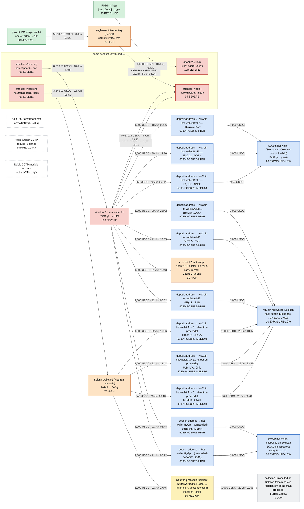

# Incident graph — Case 01 — Unauthorized PHMN mint

Generated by `python -m tools.diagrams cases/01-unauthorized-mint-juno` from `graph.json`. Colours are the risk bands from `risk/model.py` (scores and reasons: [risk.md](risk.md)). Addresses that share an account key sit in one box; dashed edges touch infrastructure. Every edge cites a transaction listed in [risk.md](risk.md#edges-used).

29 nodes, 32 edges. This is the reference picture; on GitHub use the diagram's zoom and full-screen controls. The curated summary is at the top of "How it unfolded" in the [write-up](../README.md#how-it-unfolded).

| Colour | Meaning |
|---|---|
| `severe` (fill #f8d0cc, border #b42318) | SEVERE (80-100): seed or same key as a seed |
| `high` (fill #fde3c4, border #c4570c) | HIGH (60-79) |
| `medium` (fill #fdf1b8, border #a37a00) | MEDIUM (30-59) |
| `low` (fill #eef0f2, border #6b7280) | LOW (0-29) |
| `service` (fill #d6e6fb, border #1d5fbf) | service (exchange, deposit address): exposure band, action is a freeze or KYC request |
| `infra` (fill #ffffff, border #9aa1ab) | infrastructure (vault, adapter, mixer pool, module): never scored as owner |
| `resolved` (fill #d5f0dc, border #1e7a3c) | resolved: victim or false lead |

Graph note: Every edge cites a transaction verified by checks.py. Off-chain identifiers are not part of this graph. USD for PHMN legs is left at 0 (no reliable price); USDC legs are at face value. Exchange names on service nodes come from Solscan public labels (checked 31 Oct 2026), not from chain data.
