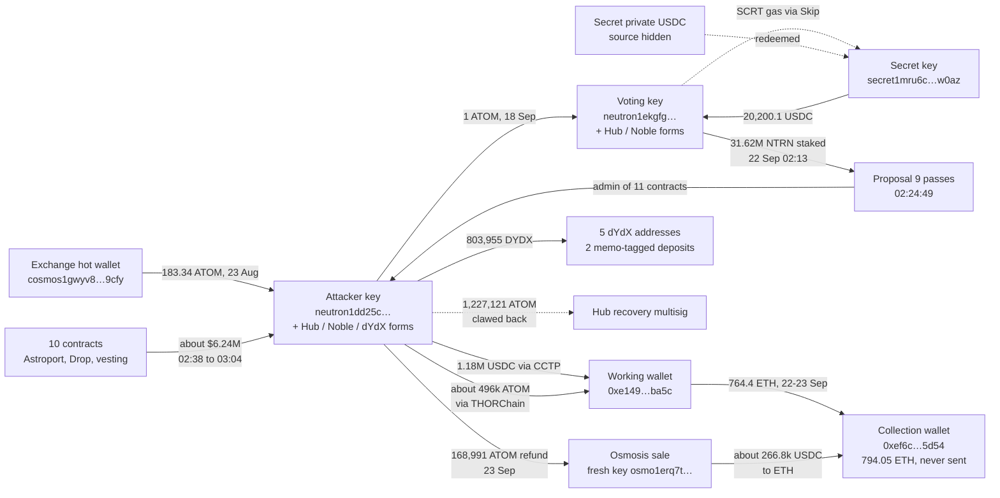
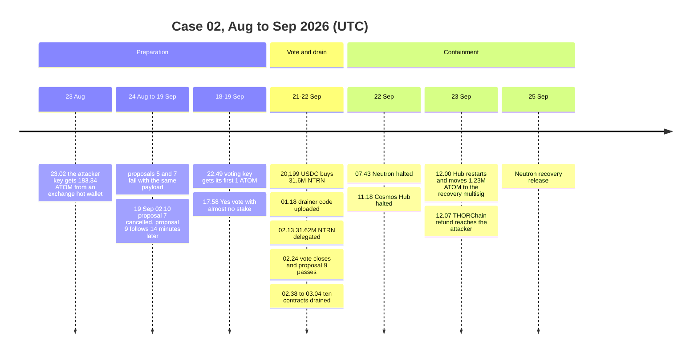
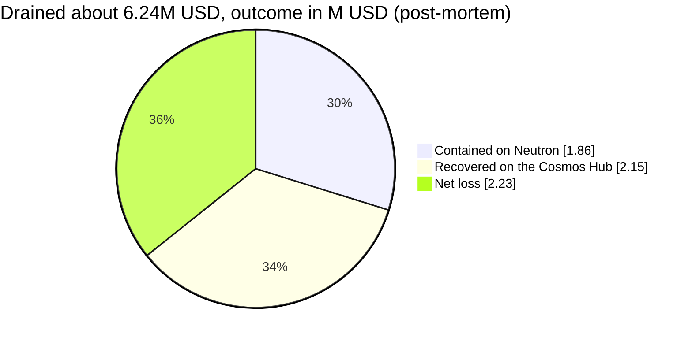

# Case 02: Governance takeover on Neutron ($20k of voting power against $6.2M in DeFi contracts)

> **Sources.** The figures follow the [official incident post-mortem](https://x.com/crypto_crew/status/2104924316357841306) (final, published after the 25 Sep 2026 restart). Prices are as of the investigation: ATOM $1.75, NTRN $0.000816, ETH $2,741.
>
> **Reproducibility.** Every key on-chain number is recomputed from raw data (archive nodes for Neutron, Cosmos Hub, Noble, Secret and dYdX, plus Ethereum RPC) by `python cases/02-neutron-governance-attack/checks.py` (37 checks, IDs `C2-xx` are cited inline). Raw responses are in `data/cache/`, pinned by `data/cache/MANIFEST.sha256`, so the checks also run offline. See [reports/verification.md](reports/verification.md) for the full table and [reports/risk.md](reports/risk.md) for the address risk scoring.

## TL;DR

On 22 Sep 2026 an attacker passed Neutron governance proposal 9. It transferred the CosmWasm admin rights of 11 contracts (8 Astroport, 2 Drop, Neutron investor vesting) to the attacker. The attacker then migrated 10 of them to its own code and drained about $6.24M.

- No bug was exploited. Neutron's `x/gov` module was authorized to change the admin of *any* contract, and the proposal used that authority exactly as designed.
- The vote was bought. A second, linked wallet spent 20,199 USDC on 31.6M NTRN and staked it 11 minutes before voting closed. That stake was 84.7 % of the Yes vote.
- Validators halted Neutron and then the Cosmos Hub. An IBC rate limiter, the halts and a recovery release secured about $4.01M (64 %). The net loss was about $2.23M.
- I took part in the response as a Neutron contributor, found where the purchased stake had gone and that a single No vote had carried the proposal over quorum. This write-up re-derives every figure of the official post-mortem from chain data and adds what it leaves out: the single No vote that lifted the proposal over quorum, the exchange deposit tags on the dYdX exit, the attacker's own Hub proposal after the clawback, and a risk score for every address (see [What this analysis adds](#what-this-analysis-adds-to-the-post-mortem)).

## Case card

| | |
|---|---|
| Dates | 23 Aug 2026 (funding), 24 Aug to 19 Sep (two failed proposals), 22 Sep (vote and drain), 22-25 Sep (halts and recovery) |
| Chains | Neutron → Cosmos Hub / Noble / dYdX / Osmosis → THORChain and Circle CCTP → Ethereum; Secret Network (vote funding) |
| Assets | CosmWasm admin rights over 11 Neutron contracts; drained USDC, ATOM, dATOM, DYDX, wstETH, axlWETH, NTRN, ASTRO |
| Loss | About $6.24M withdrawn from 10 contracts (C2-10) |
| Outcome | About $4.01M (64 %) contained or recovered; net loss about $2.23M (post-mortem figures) |
| My role | Neutron contributor in the incident response: found where the attacker's purchased stake was delegated and that a single No vote had lifted the proposal over quorum; reported both to the former Neutron team at 08:09 UTC on 22 Sep. Afterwards: independent re-verification and the additions listed below |
| Checks | 37 passed, see [reports/verification.md](reports/verification.md) |

## What this analysis adds to the post-mortem

The official post-mortem is the primary source for the figures in this write-up, and every one of its numbers that can be read from chain data is recomputed here, with a check ID:

| Post-mortem statement | Recomputed from chain | Check |
|---|---|---|
| proposal 9 handed the admin of 11 contracts to the proposer | 11 `MsgUpdateAdmin` messages in the proposal, all naming the attacker wallet | C2-01, C2-01b |
| 31.62M NTRN staked 11 minutes before voting closed, 84.7 % of Yes | delegation at 02:13:10, close at 02:24:49, 31.62M of 37.31M Yes | C2-06, C2-06b, C2-06c |
| turnout 45.57M against a quorum of about 41.05M | tally and bonded stake read at the closing height | C2-03, C2-03b, C2-03c |
| ten contracts migrated to code 5399 and drained in 26 minutes | the migrations and the `withdraw_all` calls, with amounts | C2-10, C2-10b |
| 1,180,010 USDC through CCTP, 1,723,180 ATOM to the Hub, 803,955 DYDX to dYdX | the IBC transfers and the four Noble burns | C2-11 to C2-15 |
| the rate limiter kept 1,671,302 USDC on Neutron | the balance left behind and the eight rejected transfers | C2-11b, C2-11d |
| 1,227,121.37 ATOM moved to the Hub recovery multisig at height 33,086,741 | the account balance before the halt and the block events | C2-16, C2-16b |
| the collection wallet holds 794.05 ETH and has never sent a transaction | balance and nonce re-read on 30 Oct 2026, five weeks after publication | C2-21b, C2-21c |

The following is not in the post-mortem:

- The single No vote that made the difference, which I found during the response. The post-mortem says the proposal would have failed without the purchased stake. It would also have failed without one validator's 8.08M NTRN No vote, which lifted turnout over quorum (C2-04, C2-04b). A lone No vote can be the thing that lets a malicious proposal pass; coordinated No votes would have blocked it. Both are now in Lessons learned.
- The exchange deposit tags on the dYdX exit. The post-mortem says the DYDX was split across five addresses. Four of the seven transfers carry numeric memos of the kind exchanges assign to deposit addresses, which makes two of the five addresses a KYC lead (C2-20, C2-20b).
- The price the attacker paid. Across the five Astroport swaps the NTRN price roughly doubled, from about $0.00052 to about $0.00102 per NTRN, which bounds how much more stake the same budget could have bought (C2-07, C2-07b).
- Cosmos Hub proposal 1056. The fresh key that sold the THORChain refund then asked the Hub community pool for 1,721,120 ATOM, including a bounty for Yes voters. It was rejected with 89.7 % No with veto (C2-22, C2-22b).
- The halt windows as block timestamps, not announcements (C2-18, C2-18b, C2-19, C2-19b), and the two smaller THORChain refunds beside the large one.
- A rule-based risk score for every address on the graph, including the exchange hot wallet, the dYdX deposit addresses and the resolved 1,000 USDC lead (Risk scoring).
- An off-chain lesson from the refund: a containment checklist has to include the outbound queues of bridges and DEXes, as the Hub team's own account of the refund shows.

The same-key links the post-mortem asserts between the Neutron, Noble, Cosmos Hub, Osmosis, Axelar and dYdX addresses are verified here by decoding the bech32 payloads (`tools/bech32.py`).

## Addresses

| Role | Address |
|---|---|
| Attacker wallet (Neutron) | `neutron1dd25c4sshelrpfs0433apg24c5phrhk8l6n605` |
| Attacker wallet (Cosmos Hub / Noble / Osmosis / dYdX / Axelar), same key | `cosmos1dd25c4sshelrpfs0433apg24c5phrhk8m96c4n` / `noble1dd25c4sshelrpfs0433apg24c5phrhk8nx0sda` / `osmo1dd25c4sshelrpfs0433apg24c5phrhk8n7fgrp` / `dydx1dd25c4sshelrpfs0433apg24c5phrhk8ju5u4y` / `axelar1dd25c4sshelrpfs0433apg24c5phrhk8ltvs7j` |
| Voting wallet (Neutron) | `neutron1ekgfga6vv4zdrrjn3dux6f62fuzektfndgaehm` |
| Voting wallet (Cosmos Hub / Noble), same key | `cosmos1ekgfga6vv4zdrrjn3dux6f62fuzektfnfh5mdu` / `noble1ekgfga6vv4zdrrjn3dux6f62fuzektfnp5pn4j` |
| Secret key that funded the vote | `secret1mru6cp7ft8cfasaye4g6vum52qygnkq0cgw0az` |
| Fresh key that sold the THORChain refund | `osmo1erq7tre6nk0jfx203z8ey75g4m7yfrckl3qx87` / `cosmos1erq7tre6nk0jfx203z8ey75g4m7yfrckh2nk3v` |
| Ethereum working wallet | `0xe149310eb8b1b3d9c471ccd81819d393621fba5c` |
| Ethereum collection wallet | `0xef6c5a31df984c8569236a0abc1f27580e2a5d54` |
| Ethereum wallet for the refund proceeds | `0x9bfcca13b4ac907433ac68766e96309ac867f819` |
| Exchange hot wallet (only external funding; attributed to Binance in the post-mortem) | `cosmos1gwyv83zcnckdhuz3n78rvyzj59u8x6l8dk9cfy` |
| Hub recovery multisig (4-of-6) | `cosmos1z8pq5cn7tdrwwzlwm0e44fgq07e43ner6vph64` |
| Neutron recovery multisig | `neutron1yr29fd7uzdjp2jsq8hrta8mvyd6ex7vumn0shy` |

## My role

I took part in the incident response as one of the Neutron contributors, the group credited collectively in the [Cosmos Hub recovery update](https://forum.cosmos.network/t/neutron-governance-attack-cosmos-hub-response-and-recovery-update/17369); before that I had been part of Hadron Labs, the former Neutron team. During the response I established that the attacker's purchased stake had been delegated to the POSTHUMAN validator, and that one validator's No vote was what had lifted the proposal over quorum. I reported both, together with the proposal that carried the admin transfers, directly to the former CEO of Hadron Labs in a private Telegram channel at 08:09 UTC on 22 Sep: 26 minutes after the Neutron halt, while the response teams were still mapping the attacker's addresses, and about three hours before the Cosmos Hub halt. There is no public record of those messages. Others reached the same conclusions independently, and the formal response was carried out by Solva, Hadron, the affected protocols, the security firms and the validators.

The re-verification, the additions listed above and the toolkit in this repository (`tools/`, `risk/` and each case's `checks.py`) are my own follow-up work on public data, done after the post-mortem was published.

## Background: why this was possible

- In mid-2026 Neutron replaced its DAO DAO-based governance with native Cosmos SDK `x/gov`. Proposal 9 was only the ninth native proposal on the chain. Validators were not yet used to voting there, and a popular explorer did not yet display Neutron `x/gov` proposals.
- Neutron's wasmd configuration let `x/gov` (module account `neutron10d07y265gmmuvt4z0w9aw880jnsr700j7a68v5`) modify any contract regardless of its configured admin. Proposals executed immediately: there was no allowlist of message types, no consent required from the current admin, and no timelock.
- **Expedited proposal parameters:**
  - deposit 1M NTRN, refunded unless vetoed;
  - 3-day vote;
  - quorum 30 % of bonded stake, 67 % Yes threshold.
- Each vote is weighted by stake at the end of voting, not when the vote was cast.

## How it unfolded

Short labels in the diagrams; full addresses are in the Addresses table. The complete graph with every scored address is in [reports/graph.md](reports/graph.md).

### 1. A cheap, reusable deposit (23-24 Aug)

- **Only two outside funding sources.**
  - **183.34128 ATOM** withdrawn from exchange hot wallet `cosmos1gwyv83zcnckdhuz3n78rvyzj59u8x6l8dk9cfy` on 23 Aug at 23:02 (tx `F22A5A8FBAC584F19500C296B3B8C225AA7EB26B811F1BC405B0382860E40F6E`). The post-mortem identifies the wallet as most likely Binance.
  - 20,200 USDC that came out of Secret Network's privacy layer (step 4).

  Everything else was routed between the attacker's own same-key addresses.
- Part of the ATOM was swapped through Osmosis into about 227 USDC. On Astroport that bought about 1M NTRN, enough for the deposit, for a few hundred dollars. The same deposit was reused for every attempt.

### 2. Two failed attempts (24 Aug to 19 Sep)

- **Proposal 5** (tx `BA62966ADC290151E49F3BAB8AD95194141BE42200749475A9D58E41CD3AB334`): an "AI agent governance research experiment" text wrapped around 10 × `MsgUpdateAdmin` on mainnet contracts. Rejected: Yes 0.32M vs No 10.42M (C2-02).
- **Proposal 7** (tx `B0DAC58E9B38C79698E9563ED05F3965E667819B57DC8FBEBD3AB71DA8C81552`): identical payload. The community reacted: Yes 5.28M vs No 49.01M from 97 votes. The attacker cancelled it on 19 Sep at 02:10 (tx `80A28DF252FA985B4266409527A0AA77F03E947C2A48ACBCD791FF6B74347517`) and recovered the deposit.
- **Proposal 9**, 14 minutes later (tx `50D41B97A698B62E02A1FE1E1260C758D75E1E82FCB9735BBD5BBC6381400B9E`): the same text and the same 10 messages, plus an 11th targeting the investor vesting contract (76.22M NTRN) (C2-01, C2-01b). Voting closed on 22 Sep at 02:24:49.
- Two clear rejections never turned into a protocol-level restriction, so the same payload could come back a third time.

**The 11 target contracts:**

| # | Contract | Label |
|---|---|---|
| 1 | `neutron1nfns3ck2ykrs0fknckrzd9728cyf77devuzernhwcwrdxw7ssk2s3tjf8r` | Astroport pair |
| 2 | `neutron1ns2tcunrlrk5yk62fpl74ycazanceyfmmq7dlj6sq8n0rnkuvk7szstkyx` | Astroport pair |
| 3 | `neutron1j4xpv03fw664mvntlhqnzp5hjqk2nfw00vrgx9qlq97rxc9fu3lqvmszl2` | Astroport pair |
| 4 | `neutron1yw0a7nxa8jdgzmdsme4gwxhj76n44z305qgwrzvlfavgna9epcys3k9m2f` | Astroport pair |
| 5 | `neutron1yem82r0wf837lfkwvcu2zxlyds5qrzwkz8alvmg0apyrjthk64gqeq2e98` | Astroport pair |
| 6 | `neutron18c8qejysp4hgcfuxdpj4wf29mevzwllz5yh8uayjxamwtrs0n9fshq9vtv` | Astroport pair |
| 7 | `neutron15024sa6het7qrgccrx9wtxff7mh9qrcu9m6gvvlvez6em46ylscqk4kqj9` | Drop dATOM→ATOM converter |
| 8 | `neutron1gcklauurx4ckyp0t8a6axl0500vy3n09y5utpspjg8ruxnln8erq2uumck` | Drop staking withdrawal manager |
| 9 | `neutron19sq60cxtsjcx7vw25c63wyt27fxevuh6l7vxcn04u0t0rueyfpvq4mc75l` | Astroport Treasury (never drained) |
| 10 | `neutron1zlf3hutsa4qnmue53lz2tfxrutp8y2e3rj4nkghg3rupgl4mqy8s5jgxsn` | Astroport Staking (xASTRO) |
| 11 | `neutron14q5elxj4ghktt7d7d0uw0cs0gqyeay25h5fkree897gjm38gevxqmvqsq5` | Neutron investor vesting |

### 3. Setting up the voting wallet (18-19 Sep)

- **18 Sep 22:49:** `cosmos1dd25c4sshelrpfs0433apg24c5phrhk8m96c4n` sends 1 ATOM to `cosmos1ekgfga6vv4zdrrjn3dux6f62fuzektfnfh5mdu` (C2-09; tx `0563C4A54A1A0AB504A09DB51C1186D28D87A96C59F231C69CA707B2512B9421`). These are the voting wallet's first funds anywhere, and this transfer is the on-chain link between the two keys.
- The voting wallet then routes SCRT gas through Skip to a third key on Secret Network, `secret1mru6cp7ft8cfasaye4g6vum52qygnkq0cgw0az` (tx `C753D320C37BB782C23ACF4705DADC8DBFAC6D78A442C508361270B1608FCAA6`). It also seeds a stake of a few hundred NTRN with a validator.
- **19 Sep 17:58:** it votes Yes on proposal 9 while holding almost no stake (C2-05; tx `8E0963A52E317D73E7952EC54F0FCCE2F1B2EED18658428AA4E8C10A15C2C8E7`). The vote attracted no attention, and the weight could be added later.

### 4. Buying the vote (21-22 Sep)

- **Funding:** 20,200.1 USDC was redeemed by `secret1mru6cp7ft8cfasaye4g6vum52qygnkq0cgw0az` from Secret's private SNIP-20 USDC contract `secret1chsejpk9kfj4vt9ec6xvyguw539gsdtr775us2` (label `secret-noble-usdc`) and sent through IBC to `noble1ekgfga6vv4zdrrjn3dux6f62fuzektfnp5pn4j`, then on to Neutron (C2-08, C2-08b). Encrypted balances hide the original source. Redemption txs:
  - `7F7096AC0360B629BC6B7EE9E1474AFA47F2FDA6EBAD1FC1F12E01D52FF5C747`
  - `229ED79B64894232A9B2F9CA3346ADD887A86F4B98331375AD2A72BD1374C8CF`
  - `2F54E41F88E075412F0BE3748DAAAA4B4E80688407024EBF1446DB71D2D02584`
- **Purchase:** five swaps on Astroport turned 20,199 USDC into 31,627,304 NTRN, about a quarter of all staked NTRN (C2-07, C2-07b). During the buying the price per NTRN roughly doubled, from about $0.00052 to about $0.00102 per swap (my own observation; the post-mortem does not give the price path). Swap txs:
  - `99DCA5879E75171EA4D7690CCB43DD72BF915B71A368A35BE1E5B8DD17B2313F`
  - `39B33116AF1FC16434F851467A2FDB9AD5BD640CCCA4AB7DE4175B3A3832565F`
  - `87D198D3A8E136E5F29F81030C9D8DA5954C4C5146C6B81B926F527FDDA04BDA`
  - `F3E3EF62790861A0276618C42A48EC8243A7B2AC340CF65C37F8682777720011`
  - `A2CEF410581B0DE965136E229CB9A5BD31CE3E95D5AD0CD428D7DF6698DAE015`
- **01:18:** while voting was still open, the attacker uploaded the drainer code (tx `9FD1E5BCFEFF901C639DD67601AEBDE7865529D4DA0BBBC6571DEA3C8EE89BA9`). It was labelled "migration test vault" and had a function that sends the contract's entire balance to the caller.
- **02:13:10:** the voting wallet delegates the final 31,620,000 NTRN (C2-06; tx `71FB94AE30C7CEC1F0D9B2B8BC74961DD1F3053A0BA2B4B2F0CF6E4C6C55C266`). Voting closes 11.5 minutes later (C2-06b).

### 5. Tally: what pushed it over quorum

| | NTRN |
|---|---|
| Bonded at close | 136.86M |
| Quorum (30 %) | 41.06M |
| **Yes** | **37.31M** (81.9 % of votes cast; C2-03c); the purchased stake was 84.7 % of it (C2-06c) |
| No | 8.09M |
| No with veto | 0.17M |
| Turnout | 45.57M (33.3 %; C2-03, C2-03b) |

- **Without the purchased stake** turnout would have been about 13.95M, far short of quorum.
- **The quorum paradox (my own finding, made during the response).** About 8.08M of the No votes came from a single validator (vote tx `B4F668D57CBEAC3F5EBCBC788D4FC2540C1569FFB3110D43CF0B591C09E0C1B1`). Without that No, turnout would have been 37.49M (27.4 %), *below quorum*, and the proposal would have failed despite the purchased stake (C2-04, C2-04b). Most other validators did not vote. The one that voted No, with good intent, helped the attack reach quorum.
- **The post-mortem's counter-view.** Coordinated No votes from most validators, which also count for their non-voting delegators, would most likely have stopped this attempt. Liquidity in the routes the attacker used (about 43.85M NTRN) could not outweigh them. Both observations hold: a lone No vote helped the attack, a coordinated No would have defeated it. Either way, validator voting raises the cost of an attack but does not make it impossible.

### 6. Drain (02:38-03:04 UTC)

For each contract the attacker migrated to code 5399 (the action was logged as `migrate_to_v2`, and the contract's cw2 version record was overwritten) and then called `withdraw_all`. Ten contracts were emptied in 26 minutes (C2-10, C2-10b):

| Contract | Drained | `withdraw_all` tx |
|---|---|---|
| Astroport Staking (xASTRO) | 370.3M ASTRO | `7B155828BAB0B4325B86793D226F9872922EBAFAAAF62F341A1FDDE13E162C96` |
| USDC/dATOM pool (`neutron1nfns3ck2ykrs0fknckrzd9728cyf77devuzernhwcwrdxw7ssk2s3tjf8r`) | 2.22M USDC, 849,316 dATOM | `94AF6AD7A7DFE7744A9464223BCF65FF7212285B0B0C67CCE37AEBF971F86DB3` |
| axlUSDC/USDC pool (`neutron1ns2tcunrlrk5yk62fpl74ycazanceyfmmq7dlj6sq8n0rnkuvk7szstkyx`) | 500,001 USDC | `A9DF14C872A228E79F442C5A32F5875D6AD4A15E9BBA5500DC461D04A2A2A703` |
| USDC/DYDX pool (`neutron1j4xpv03fw664mvntlhqnzp5hjqk2nfw00vrgx9qlq97rxc9fu3lqvmszl2`) | 112,588 USDC, 803,955 DYDX | `18367299AED50A1E8EF5A9CBECDB0B85391671325B3BE967BD1F5D2802EC9DBF` |
| wstETH/axlWETH pool (`neutron1yw0a7nxa8jdgzmdsme4gwxhj76n44z305qgwrzvlfavgna9epcys3k9m2f`) | 15.99 wstETH, 20.09 axlWETH | `035FA91D572BDFF71A8E97E2F2C8E272A85E7C90287F16B368AC2727CACA7E51` |
| ATOM/dATOM pool (`neutron1yem82r0wf837lfkwvcu2zxlyds5qrzwkz8alvmg0apyrjthk64gqeq2e98`) | 17,590 ATOM, 7,829 dATOM | `CCF1F5651A6304934B142B4B538AEBCAD935D97727BA5AB073876D53C50BFD0D` |
| USDC/NTRN pool (`neutron18c8qejysp4hgcfuxdpj4wf29mevzwllz5yh8uayjxamwtrs0n9fshq9vtv`) | 20,324 USDC, 18.97M NTRN | `ADE7EDA63A6B4FF03451A2762F8EC557E30B47EFE9F0449DE206ED5D2C1045EA` |
| Drop dATOM→ATOM converter | 1.59M ATOM, 735,337 dATOM | `629BB0DFE20D5E3FC1259AA1664292AC7DC5CDF964F91097D58AAE2E68A1D8A5` |
| Drop withdrawal manager | 115,878 ATOM | `34CC01E26CD31AE94B964F13A6BDD991F8C67B86F6548EF97E5091CBC72FA18B` |
| Neutron investor vesting | 76.22M NTRN | `490AE752244EAB51A1C9E710C7E4B817150DCEB4B17ECBD19FD28A2B1747A5CE` |

The matching `MsgMigrateContract` txs are listed in [reports/verification.md](reports/verification.md). The 11th contract, Astroport Treasury (362.1M ASTRO), was taken over but never drained. Total withdrawn was about $6.24M. dATOM is counted at $0 to avoid double-counting the ATOM backing it.

### 7. Exit routes

| Asset | Route | Result |
|---|---|---|
| USDC 1,180,010 (C2-11) | IBC → `noble1dd25c4sshelrpfs0433apg24c5phrhk8nx0sda` → Circle CCTP → Ethereum `0xe149310eb8b1b3d9c471ccd81819d393621fba5c` (C2-14, C2-14b) → about 430 ETH | Lost. The ICS20 rate limiter rejected 8 further transfers ("USDC-DAY-1 quota exceeded", C2-11b), keeping 1,671,302 USDC on Neutron (C2-11d). |
| ATOM 1,723,180.290498 (C2-12) | IBC → `cosmos1dd25c4sshelrpfs0433apg24c5phrhk8m96c4n` → THORChain streaming swaps to ETH (100k / 200k / 200k ATOM, C2-15, C2-15b) | About 496k ATOM lost. 1,227,121 ATOM recovered (below). |
| DYDX 803,955.137 (C2-13) | IBC → `dydx1dd25c4sshelrpfs0433apg24c5phrhk8ju5u4y` → five addresses (C2-20) | Lost. Four of the seven transfers carry numeric memos that look like exchange deposit tags, a KYC lead the post-mortem does not mention (C2-20b). |
| wstETH 15.99, axlWETH 6 | Lido Satellite / Axelar / Osmosis / Squid → Ethereum | Lost. The rate limiter blocked the remaining 14.09 axlWETH. |
| NTRN, ASTRO | Not enough liquidity to sell or bridge | Contained |

**Noble CCTP burns to Ethereum** (sum 1,180,004.61 USDC; C2-14):
- `F88A8339C9564D95906272253BA9A79D97A764FAD10C423891951E6BF50644A7` (499,999.92 USDC)
- `1ADB2E2E74E13FD6747977F7FF9E616C3E320B7368F8B80A7B6CC557609364AA` (499,999.90 USDC)
- `DB74700CB019A5AD96EEB24D2560F0C85A275AE8B497C0CCC93BF38516B74846` (174,999.88 USDC)
- `C9624D983081D494321C1C1253FA1FDE65DA055193AACA34110F2F7B3A4A9235` (5,004.92 USDC)

**DYDX transfers:**

| DYDX | Recipient | Memo | Tx |
|---:|---|---|---|
| 100,000 | `dydx1g3yxx6any5xfm6cvhhmhpegfzh2jxzmdlpg5pa` | none | `048F04E63DC9668702EE73C254B372B8B45F61A51C92239DF0607EC9CFED1370` |
| 200,000 | `dydx17nnea956ys2m2nl6r6dsuje66kg9huhc4tnspd` | none | `04483152F679D68DF7815360D8CC65C36491D38FD331A8ABB003F17EA2679E42` |
| 250,000 | `dydx16xkl6xavvq2748e6pkzt4rrnatzcqw6j9j7nra` | none | `F3AF900A9C0EFC845289E714EF4938423889428889C6B489C77D0CA7E98EA9CF` |
| 50,000 | `dydx18akpm48gz0v20pg3qx7epxgw93q2sutja0gfzs` | `2096822738` | `A06392A9D4116802B429B56202F2180285E3F029DB5AA9085865B92D81A48B08` |
| 100,000 | `dydx18akpm48gz0v20pg3qx7epxgw93q2sutja0gfzs` | `2096877152` | `6956C8830E770D52389D8CE28EC5DEA9E18226B20BF7F375F057CFCA97996349` |
| 50,000 | `dydx1plrw2mur00y6mh94vc4u5y9wz56ktdnt6ep4gq` | `10081171` | `817FC6FC6AC33CC98A420782F36BC85399AB64030B5023271CB915F0A5AE2791` |
| 53,955 | `dydx18akpm48gz0v20pg3qx7epxgw93q2sutja0gfzs` | `2096877338` | `C2FB1FFFE1B922BE919C120270F89CF92DB76327A657E5889FFC18346AC4C095` |

**Ethereum consolidation:**
- On 22 Sep, `0xe149310eb8b1b3d9c471ccd81819d393621fba5c` sent 670 ETH to the fresh collection wallet `0xef6c5a31df984c8569236a0abc1f27580e2a5d54` in two transfers (the post-mortem counts 671 ETH for that day):
  - 500 ETH: `0x1c3a5dfe64998aabfa18ea17a894b12c5e4d06507c96738ddf236ab4348cefc4`
  - 170 ETH: `0xc19ea5b70bae47619d73b24f51456dfd6c84c585e19166d4a44b41feb95818df`
- On 23 Sep a further 94.4 ETH followed: `0x4c3852241b01c3070aefe65ad69d1b7723da7600fb2195d45850601aff06bf9e` (C2-21).
- **The collection wallet holds 794.05 ETH and has never sent a transaction** (nonce 0; C2-21b, C2-21c).
- Look-alike `0xEF6c…` addresses in the trace are address-poisoning bots.

**THORChain legs** (Cosmos Hub; vaults `cosmos10h3h0t48v60rx9cg88fq0gckmhh2mxu5fdyxua` and `cosmos1p0jus87dalh7xku22tx3uhyhlf8cjuc06kguk0`):

| Leg | Tx |
|---|---|
| Test swap 20 ATOM → ETH (21 Sep) | `F5A138537B1A6BD5EABEC32E3FBFC61A0EEC11E0BB208DDC331636035130643E` |
| Swap 100,000 ATOM | `391357A492268DBEFD575855B41AD55888BD8225CF367E007701C08470BB8350` |
| Swap 200,000 ATOM | `398959FE1BFF680B0BEC868A811F567BA17D8414EF2C4FCC176F665E856E31E6` |
| Swap 200,000 ATOM (refund escaped) | `02DABD55C0A3EBEA3271763484542CB59A22E968402F91690471B7D2589B04A7` |
| Refund 76.428533 ATOM | `790C08E65983DC2EFC1676BDFD8E39E72B7C60F70E6CFCBA8AEDB410106389FA` |
| Refund 3,853.423813 ATOM | `A6A6A4570B2FA6B4C91414768129E4082DF0F824FAD69C99A1E15CC04B0D9E3C` |
| Refund 168,990.898794 ATOM | `8E61D1F85FD9A8BE36A2EF00EE4FD5FB92616DB88C67B091D4A608695B855202` |

## False leads, resolved

**1. A bought Yes vote.** The attacker sent 1,000 USDC to the account that cast the second-largest Yes vote, `neutron15m3hh904d0cwe4t69ec2w5cmc8535gkxwhgrp5` (5.09M NTRN), three hours after the drain (tx `DE1D6CDF3B4AEB42B9DAB0D893AB04BBB77AC64C2539B6CBF475A69A960CA122`). On-chain, that looks like vote-buying. The investigation found no link to the attack, and the owner returned the 1,000 USDC to the recovery multisig.

A fund-flow edge is a lead until something else confirms it. Until the owner came forward, I recorded it only as "possible vote-buying, not established". The risk model reflects this: a raw score of 45, band RESOLVED.

## Containment and recovery

- **07:34 on 22 Sep:** the community alerted the former Neutron team. At 07:43 validators halted Neutron (last block 61,635,573), so the attacker's remaining Neutron balances could no longer move. Block timestamps show the gap from 2026-09-22 07:43:57 to 2026-09-25 13:28:59 (C2-18, C2-18b).
- **11:18 on 22 Sep:** with the attacker actively selling through THORChain, Cosmos Hub validators halted the Hub at block 33,086,740.
  - **12:00 on 23 Sep:** the Hub restarted on Gaia v28.3.0 with a one-time state change. It moved the attacker's remaining 1,227,121.374688 ATOM (C2-16) to the 4-of-6 recovery multisig `cosmos1z8pq5cn7tdrwwzlwm0e44fgq07e43ner6vph64` (block 33,086,741 events; C2-16b). No other account was touched. The Hub halt lasted from 2026-09-22 11:18:23 to 2026-09-23 12:06:23 (C2-19, C2-19b).
- **The THORChain refund gap.** When the Hub halted, the attacker's last swap (`02DABD55C0A3EBEA3271763484542CB59A22E968402F91690471B7D2589B04A7`, 200,000 ATOM) had filled only 15.5 %. THORChain queued the unfilled 168,990.898794 ATOM as a refund. The refund was not visible as a balance on the account, only in THORChain's outbound queue, and the patched binary had already been distributed.
  - 12:07, 7 minutes after the restart: the refund lands on the attacker's address (tx `8E61D1F85FD9A8BE36A2EF00EE4FD5FB92616DB88C67B091D4A608695B855202`).
  - 17:54: the attacker moves it to Osmosis (C2-17; tx `95BF481B9556389EA05340C47EADFA28CAA547F7E019D30B9D9A50C70D036285`) and sells it for about 266.8k USDC, partly through the fresh key `osmo1erq7tre6nk0jfx203z8ey75g4m7yfrckl3qx87`.
  - The proceeds are bridged to Ethereum (CCTP, and Axelar → Uniswap into `0x9bfcca13b4ac907433ac68766e96309ac867f819`), and the ETH is consolidated into the same collection wallet.
  - The same fresh key, as `cosmos1erq7tre6nk0jfx203z8ey75g4m7yfrckh2nk3v`, then submitted Cosmos Hub proposal 1056 (not covered by the post-mortem), "ATOM Refund & Justice Bounty" (C2-22b). It asked for 1,721,120 ATOM from the community pool, including 500,000 ATOM to be paid to Yes voters. It was rejected with 89.7 % No-with-veto (C2-22).
- **25 Sep, Neutron recovery release** (tied to fixed block heights, since a halted chain cannot run an upgrade plan):
  - all 11 contracts restored to their original code IDs, cw2 records and admins;
  - the purchased 31.62M NTRN delegation removed without unbonding;
  - pre-listed amounts clawed back to the 5-signer recovery multisig `neutron1yr29fd7uzdjp2jsq8hrta8mvyd6ex7vumn0shy`;
  - both attacker accounts locked;
  - new delegations frozen;
  - governance limited to software-upgrade and text proposals.
- **Recovered funds** stay in the two multisigs until each chain's governance authorizes a distribution to affected users.

**Outcome (official figures):**

| | USD |
|---|---|
| Withdrawn from contracts | about 6.24M |
| Contained on Neutron (rate limit + halt) | 1.86M |
| Recovered on the Cosmos Hub | 2.15M |
| **Net loss** | **about 2.23M**: 1.18M USDC, about 496k ATOM, DYDX, wstETH, WETH |

## Risk scoring

`python -m risk.score cases/02-neutron-governance-attack` scores every address in `graph.json` with the rule set in `risk/model.py`. Full table with reasons: [reports/risk.md](reports/risk.md). The whole graph, coloured by band: [reports/graph.md](reports/graph.md). Excerpt:

| Score | Band | Address | Main reasons |
|---:|---|---|---|
| 100 | SEVERE | `neutron1dd25c4sshelrpfs0433apg24c5phrhk8l6n605` | R1 seed: proposer and drainer |
| 100 | SEVERE | `neutron1ekgfga6vv4zdrrjn3dux6f62fuzektfndgaehm` | R1 seed; R11 vote with negligible stake, then large delegation minutes before close |
| 95 | SEVERE | same-key forms on Cosmos Hub, Noble, dYdX | R2 same 20-byte key |
| 70 | HIGH | `secret1mru6cp7ft8cfasaye4g6vum52qygnkq0cgw0az` | R4 funded the voting wallet before the vote, R8 privacy-layer funding, R7 fresh |
| 70 | HIGH | `0xe149310eb8b1b3d9c471ccd81819d393621fba5c` | R3 received $1.18M directly from a same-key address, R7 fresh |
| 70 | HIGH | `0xef6c5a31df984c8569236a0abc1f27580e2a5d54` | R3b received $2.1M from a HIGH-scored wallet, R10 dormant accumulation, R7 fresh |
| 60 | HIGH | three DYDX recipients without memo | R3 direct receipt from a same-key address |
| 60 | EXPOSURE-HIGH | two memo-tagged DYDX deposit addresses | service exposure → identify exchange, KYC request for the memo tags |
| 45 | EXPOSURE-MEDIUM | `cosmos1gwyv83zcnckdhuz3n78rvyzj59u8x6l8dk9cfy` | funded the attacker before the incident → KYC request for the withdrawal |
| 45 | RESOLVED | `neutron15m3hh904d0cwe4t69ec2w5cmc8535gkxwhgrp5` | R3 + M1 established history; resolved: funds returned |
| 0 | N/A | THORChain vaults, Skip adapter, private-USDC contract, recovery multisig | infrastructure, never scored as owner |

## Confidence assessment

| Level | Statement |
|---|---|
| **Proven (on-chain)** | Proposal 9 carried the admin transfers for 11 contracts and passed (C2-01, C2-01b, C2-03). The voting wallet's 31.62M NTRN delegation, 11.5 minutes before close, was 84.7 % of the Yes vote, and without it turnout was far short of quorum (C2-06, C2-06b, C2-06c). The attacker key and the voting key are linked by a 1 ATOM transfer (C2-09), and each controls same-key addresses on several chains. Ten contracts were migrated and drained (C2-10, C2-10b). The exit amounts and routes (C2-11 to C2-15, C2-20). 1,227,121 ATOM moved to the Hub recovery multisig (C2-16, C2-16b). The collection wallet holds 794.05 ETH and has never sent a transaction (C2-21b, C2-21c). |
| **Strong** | The Secret key that redeemed the 20,200.1 USDC is controlled by the same operator as the voting wallet: the voting wallet paid its gas through Skip, and it sent the USDC straight to the voting wallet's Noble form (C2-08, C2-08b). |
| **Moderate** | The exchange hot wallet that funded the attacker is Binance's (the post-mortem says "most likely"). The memo-tagged DYDX recipients are exchange deposit addresses (numeric memos, C2-20b); the exchange is not identified. |
| **Suspicion** | The 1,000 USDC sent to the second-largest Yes voter looked like vote-buying. Resolved: the owner returned it and no link to the attack was found (False leads, 1). |
| **Not established** | Who controls the attacker keys. Where the 20,200 USDC came from before Secret Network's privacy layer. |

## Limitations

- Secret Network's SNIP-20 balances are encrypted, so the vote money can be followed only from its redemption (C2-08). Its source is hidden.
- USD figures for loss, containment and recovery are the post-mortem's. Token amounts are recomputed from chain data; prices are as of the investigation (header note).
- The exchange attributions (Binance for the funding withdrawal, unidentified exchanges for the DYDX memo tags) come from the post-mortem and from memo patterns, not from exchange confirmation.
- The halts, the Hub state change and the Neutron recovery release are described from block data and public announcements. I was not part of those decisions.

## Open leads

1. **Exchange-side KYC.**
   - The attacker's only traceable external funding was a withdrawal from exchange hot wallet `cosmos1gwyv83zcnckdhuz3n78rvyzj59u8x6l8dk9cfy` (183.34 ATOM, 23 Aug).
   - On the exit side there are the memo-tagged DYDX deposits to `dydx18akpm48gz0v20pg3qx7epxgw93q2sutja0gfzs` and `dydx1plrw2mur00y6mh94vc4u5y9wz56ktdnt6ep4gq`.
2. **The dormant collection wallet** `0xef6c5a31df984c8569236a0abc1f27580e2a5d54` (794.05 ETH): continuous monitoring.
3. **The Secret Network private-USDC source** behind the 20,200 USDC.

## Lessons learned

- If `x/gov` can reassign the admin of any contract, every application on the chain is protected only by the market value of governance stake. Here about $20k of stake unlocked $6.24M.
- Validator No votes raise the cost of an attack but leave the risk in place. Lasting fixes limit what governance can do:
  - an allowlist of message types that governance may execute;
  - consent from the current admin;
  - a timelock between passage and execution.
- Below quorum, a single No vote can be what lets a malicious proposal pass. Validators need to know when abstaining, or coordinating a veto, works better than a lone No.
- The attack was visible for days before it executed:
  - `MsgUpdateAdmin` / `MsgMigrateContract` in a proposal;
  - repeated resubmission of a rejected payload;
  - a Yes vote with negligible stake;
  - a large delegation from that same voter minutes before close;
  - drainer code uploaded before the vote ended.
- The ICS20 rate limiter alone kept about $1.7M on-chain.
- The Hub clawback missed a THORChain refund that was queued off-chain and arrived seven minutes after the restart. A containment checklist should include the outbound queues of bridges and DEXes, not only account balances (my own conclusion from the refund timeline).

## Appendix: key references

All hashes can be opened in Mintscan (Cosmos chains) or Etherscan (Ethereum). Official post-mortem: https://x.com/crypto_crew/status/2104924316357841306. The complete evidence index, including every `MsgMigrateContract` and rate-limit rejection, is in [reports/verification.md](reports/verification.md).

| Event | Chain | Reference |
|---|---|---|
| Only external funding (exchange withdrawal, 183.34 ATOM) | Cosmos Hub | `F22A5A8FBAC584F19500C296B3B8C225AA7EB26B811F1BC405B0382860E40F6E` |
| Proposal 5 submitted | Neutron | `BA62966ADC290151E49F3BAB8AD95194141BE42200749475A9D58E41CD3AB334` |
| Proposal 7 submitted / cancelled | Neutron | `B0DAC58E9B38C79698E9563ED05F3965E667819B57DC8FBEBD3AB71DA8C81552` / `80A28DF252FA985B4266409527A0AA77F03E947C2A48ACBCD791FF6B74347517` |
| Proposal 9 submitted | Neutron | `50D41B97A698B62E02A1FE1E1260C758D75E1E82FCB9735BBD5BBC6381400B9E` |
| Link between the two keys (1 ATOM) | Cosmos Hub | `0563C4A54A1A0AB504A09DB51C1186D28D87A96C59F231C69CA707B2512B9421` |
| Voting wallet's Yes vote with near-zero stake | Neutron | `8E0963A52E317D73E7952EC54F0FCCE2F1B2EED18658428AA4E8C10A15C2C8E7` |
| Largest single No vote (validator) | Neutron | `B4F668D57CBEAC3F5EBCBC788D4FC2540C1569FFB3110D43CF0B591C09E0C1B1` |
| Drainer code upload | Neutron | `9FD1E5BCFEFF901C639DD67601AEBDE7865529D4DA0BBBC6571DEA3C8EE89BA9` |
| **Last-minute delegation, 31.62M NTRN** | Neutron | `71FB94AE30C7CEC1F0D9B2B8BC74961DD1F3053A0BA2B4B2F0CF6E4C6C55C266` |
| First drain (Astroport Staking) | Neutron | `7B155828BAB0B4325B86793D226F9872922EBAFAAAF62F341A1FDDE13E162C96` |
| First IBC rate-limit rejection | Neutron | `90D4ED36DBBA57C31BD2FB40BF26B5B19D74B044C82D7E02B41FFF7FCEDF27E8` |
| 1,000 USDC to the unrelated Yes voter (returned) | Neutron | `DE1D6CDF3B4AEB42B9DAB0D893AB04BBB77AC64C2539B6CBF475A69A960CA122` |
| Hub recovery state change | Cosmos Hub | block 33,086,741 events → `cosmos1z8pq5cn7tdrwwzlwm0e44fgq07e43ner6vph64` |
| Refund moved to Osmosis | Cosmos Hub | `95BF481B9556389EA05340C47EADFA28CAA547F7E019D30B9D9A50C70D036285` |
| ETH to collection wallet (500 ETH) | Ethereum | `0x1c3a5dfe64998aabfa18ea17a894b12c5e4d06507c96738ddf236ab4348cefc4` |
| Attacker's "refund + bounty" proposal | Cosmos Hub | gov proposal 1056 |
