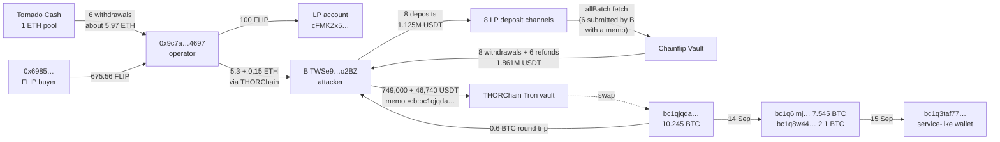
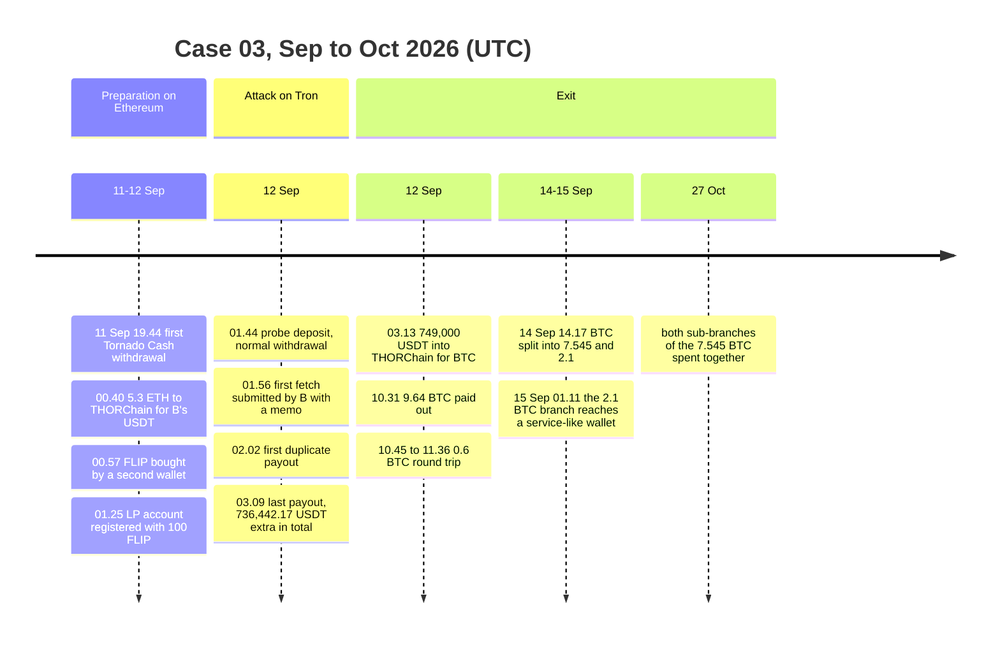
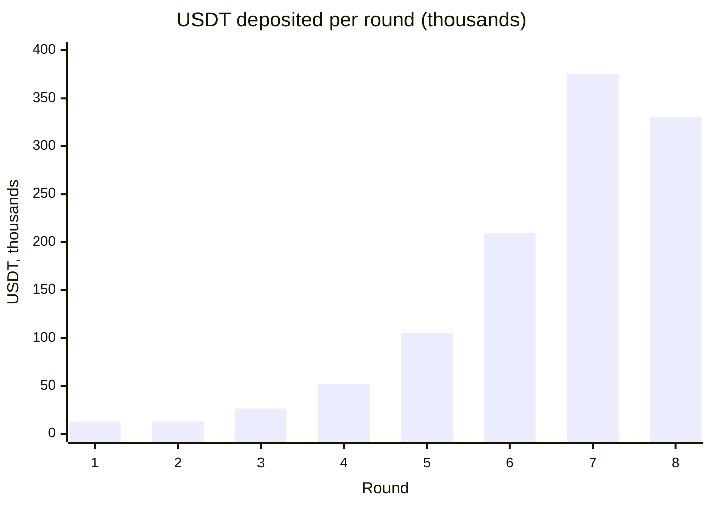
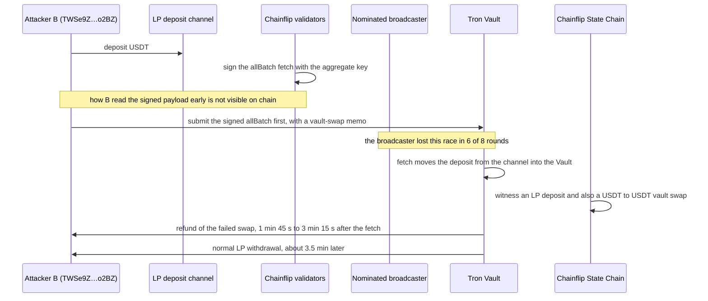

# [DRAFT] Case 03: Chainflip on Tron (736,442 USDT taken by re-submitting signed fetches with an extra memo)

> **Sources.** Chainflip's own account is the [incident report of 13 Sep 2026](https://chainflip.io/blog/tron-usdt-exploit-what-happened-and-what-happens-next), the [restart plan of 15 Sep](https://chainflip.io/blog/getting-chainflip-back-up-and-running) and the fix in [chainflip-backend release 2.2.13](https://github.com/chainflip-io/chainflip-backend/releases/tag/2.2.13). Contract addresses come from [Chainflip's mainnet address list](https://docs.chainflip.io/protocol/supported-chains-assets/mainnet-addresses), the memo format from the [Tron vault-swap docs](https://docs.chainflip.io/brokers/vault-swaps-api/tron), and the broadcast model from [Egress: broadcasting funds](https://docs.chainflip.io/protocol/egress-broadcasting-funds). Press coverage repeats Chainflip's statements: [crypto.news](https://crypto.news/chainflip-loses-736442-usdt-in-tron-exploit/), [CryptoSlate](https://cryptoslate.com/chainflip-to-reset-tron-usdt-provider-balances-to-zero-following-736000-exploit/), [Unchained](https://unchainedcrypto.com/chainflip-plans-to-restart-with-tron-paused-and-provider-balances-reset/). As of 31 Oct 2026 I found no public fund-flow analysis with addresses or hashes.
>
> **Reproducibility.** Every number is recomputed from raw data (TronGrid, THORNode, mempool.space, Ethereum RPC, a Chainflip State Chain node) by `python cases/03-chainflip-tron-duplicate-payouts/checks.py`: 37 checks plus 10 informational readings, IDs `C3-xx` cited inline. Raw responses are in `data/cache/`, pinned by `data/cache/MANIFEST.sha256`, so the checks run offline. Full table: [reports/verification.md](reports/verification.md). Address scoring: [reports/risk.md](reports/risk.md). USD: USDT at face value, BTC at the rate implied by the exit swap (about $77,668), ETH at the rate implied by the funding swap (about $2,502).

## TL;DR

On 12 Sep 2026, between 01:44 and 03:10 UTC, one fresh Tron address took 736,442.17 USDT out of Chainflip's Tron Vault.

- The attacker was a registered Chainflip liquidity provider. It deposited USDT through its own LP deposit channels, then submitted the Vault's signed `allBatch` fetch call itself, before Chainflip's broadcaster did, with a Tron memo attached. The memo was a vault swap that could not succeed (USDT on Tron to USDT on Tron), so Chainflip refunded it on top of the normal LP withdrawal. Six memos produced six extra refunds, which add up exactly to the reported loss (C3-12 to C3-16, C3-30, C3-31).
- Each round re-deposited the whole balance, so the stake doubled every ten minutes: 13k, 26k, 52k, 105k, 210k (C3-09b).
- Ten minutes after the last payout the attacker sent 749,000 USDT into THORChain and received 9.64358613 BTC. The stolen USDT sat on a freezable Tron address for about 71 minutes; nobody froze it (C3-18, C3-19, C3-28E).
- The operator is one Ethereum address, `0x9c7a…4697`. Tornado Cash paid it about 5.97 ETH in the hours before the attack. It bought the attacker's working capital and gas through THORChain and registered the LP account whose Tron refund address is the attacker's address (C3-32 to C3-36).
- On Bitcoin, one branch of the proceeds ends in a service-like hot wallet on 15 Sep, and both sub-branches of the other were spent together on 27 Oct (C3-38, C3-40).
- An apparent "service wallet cashing out at Binance" is a THORChain vault paying other people's swaps (C3-26).

## Case card

| | |
|---|---|
| Dates | 11 Sep 2026 19:44 to 12 Sep 01:25 (preparation), 12 Sep 01:44 to 03:10 (attack), 12 Sep to 27 Oct (exit to Bitcoin) |
| Chains | Ethereum → THORChain → Tron → THORChain → Bitcoin; Chainflip State Chain |
| Assets | USDT (TRC-20) in Chainflip's Tron Vault; ETH and FLIP for the setup; BTC on exit |
| Loss | 736,442.17 USDT in six duplicate payouts (C3-02, C3-16) |
| Outcome | Nothing frozen: the USDT left Tron for Bitcoin 71 minutes after the first duplicate payout (C3-18, C3-19), and Tether's freeze list never named the attacker's address (C3-28T, C3-28E). Chainflip fixed the witnesser in release 2.2.13 |
| My role | Independent analysis of public data, done blind before reading Chainflip's posts |
| Checks | 37 passed plus 10 informational readings, see [reports/verification.md](reports/verification.md) |

## What this analysis adds to Chainflip's report

I did the trace blind: from raw chain data, about seven weeks after the incident, and read Chainflip's posts only afterwards. Everything Chainflip published is reproduced independently from chain data:

| Chainflip's statement | Recomputed from chain | Check |
|---|---|---|
| 736,442.17 USDT taken in six unauthorised payouts | the first payout of each of six doubled pairs sums to 736,442.17; no other subset of the 14 payouts does | C3-02, C3-16 |
| between 01:44 and 03:10 UTC | first deposit 01:44:27, last payout 03:09:48 | C3-08, C3-14 |
| eight attempts over about ninety minutes, six successful | 8 deposits, 6 of them paid twice | C3-15 |
| small at first, then roughly doubling | rounds 3 to 6 re-deposit the entire balance to the micro-unit | C3-09b |
| a memo attached to a transaction validators had already signed | the 6 extra payouts follow `allBatch` calls carrying a valid threshold signature, submitted by the attacker with a memo | C3-12, C3-13, C3-31 |
| read as a failed swap and refunded | each memo is a USDT(Tron) to USDT(Tron) vault swap with destination and refund address both set to the attacker | C3-30 |
| six LP withdrawals were paid out twice | the attacker's State Chain account is a liquidity provider | C3-33 |

The posts contain no addresses or transaction hashes, and the press noted that payout hashes were not published. These findings are not in any public source I could find:

- the attacker's address, the 8 deposit channels, all 14 payouts and the 6 duplicates with full hashes;
- the transaction type behind "already signed" (Vault `allBatch`, selector `0x5f8c0f9a`, with the key-manager nonce inside each payload) and the exact content of the memo;
- the preparation on Ethereum: Tornado Cash withdrawals, a second wallet buying FLIP, and the LP account registered 19 minutes before the first deposit;
- the exit: THORChain to Bitcoin ten minutes after the last payout, a 0.6 BTC round trip, and the Bitcoin trail to 27 Oct with a service-like hot wallet as the main lead;
- the 71-minute window in which the USDT could have been frozen;
- the resolved false lead through THORChain vault payouts.

Chainflip knows one thing this analysis cannot see: whom it "flagged the exploited funds" with, and what came of it.

## Addresses

| Role | Address |
|---|---|
| Chainflip Tron Vault (victim) | `TEcDijvKSXcfWT7S6rd44H5vNgufm7Y4XC` |
| Attacker (B), created 12 Sep 00:55 | `TWSe9ZFc26fQo5vgramdwMCUWi2oKwo2BZ` |
| Attacker's Chainflip LP account | `cFMKZx5J8NkiJ6JxHatodMRumCnzvmVtF62FGWMnWcspg58bs` |
| Ethereum operator | `0x9c7a63fadc892df1236f959f76cd0f686de14697` |
| Second Ethereum wallet (bought the FLIP) | `0x6985ef5b59f80107cd5ed94e58e299d0dd47d1d9` |
| Tornado withdrawal address that forwarded ETH | `0x9732b5296711e24bdbd1f7538c6561617478d8da` |
| Tornado Cash 1 ETH pool | `0x47ce0c6ed5b0ce3d3a51fdb1c52dc66a7c3c2936` |
| BTC destination of the exit | `bc1qjqda2hp3yajkkm74t8j9rz7ljghfp8akyyqv55` |
| BTC address used in the round trip | `bc1quufu2t6pzgzg66wqsat4vjsh9llddda96hweys` |
| BTC hops on 14 Sep | `bc1q6lmjljevzrtjrpjjn9y2p4laegpr26zvztdegd` (7.5450169 BTC), `bc1q8w445lug39qj4fd9n84cmu8nccl8jthfmvuve6` (2.1 BTC) |
| Service-like hot wallet at the end of the 2.1 BTC branch | `bc1q3taf77uw57eaarephnxzryelc0dslz3tpdky25` |
| THORChain Tron vault, exit inbound (H) | `TLGFEbHhDS1wHYX4SQwHhdukPKZYtJ4xzt` |
| THORChain Tron vaults that paid the funding | `TDGbEeTP6QQ1iCJ6twP5FNCDrbHTBme44f` (USDT), `TMKfq5gixvpSavgqXhe4yfAbnAzW1a1UeL` (TRX) |
| Deposit channels used (all created by the Vault, C3-10) | `TBuFHA6cxBKRuE7QcdkzqYyWhtSM6gXnCZ`, `TRQ88sGrerfrPgHiQQgWqBUSjsqb11gdxm`, `TLQ3YSviESxx3nim9dhcvFrs6Gyn8zKfu2`, `TPMHrJf1qiXVAnWZpa3FeDaFYg7uSmrySv`, `TWDWWXZv74W33PYXPiZqkjYcKdwj3aKPSU`, `TCKv1KpizuUfrQFr8pzwPtQRtrQBaBEVF3`, `TKDcouiTiqwV7uEkuvwm3Y1PdBBW8AUQVB`, `TT2fLntae72J9Kkw24je7VLSecFwFT4U3P` |

## My role

Independent analysis of public data. I had no involvement with Chainflip or its response. The only outside inputs to the trace were the loss figure and Chainflip's one-line description of the cause; the comparison with Chainflip's posts above was made after the trace was finished.

## Background: LP deposits, fetches and memos on Tron

- A Chainflip liquidity provider funds its State Chain account through a deposit channel: a small contract deployed by the Vault. The protocol later moves the funds into the Vault with a fetch, here a Vault `allBatch` call signed by the validators' aggregate key. The LP's balance is credited, and the LP can withdraw it again, which the Vault pays out.
- On Tron, Chainflip also supports vault swaps. The user sends tokens straight to the Vault and puts the swap instructions in the Tron transaction memo (`raw_data.data`), a SCALE-encoded tuple of output asset, destination and swap parameters including a refund address ([docs](https://docs.chainflip.io/brokers/vault-swaps-api/tron)). A swap that cannot execute is refunded to that address.
- A fetch is also a transaction into the Vault, and Chainflip's docs say a signed transaction can be submitted by anyone; the protocol only nominates one validator to do it. That overlap is the bug.

### The exploit, step by step

What follows rests on three kinds of evidence: chain data (with check IDs), Chainflip's own statements (incident report, restart plan, release 2.2.13), and my interpretation of the two, which is labelled where it appears.

#### Two ways USDT enters the Vault, one witnesser

Chainflip's validators watch the Tron Vault and turn every incoming transfer into an event on the State Chain. Two kinds of transfer arrive there:

| | Deposit through a channel (fetch) | Vault swap |
|---|---|---|
| Who sends the tokens | the protocol: an `allBatch` call pulls them from the channel contract into the Vault | the user, with a plain TRC-20 transfer to the Vault |
| What tells the protocol what to do | the channel itself: it belongs to one account and one purpose | the memo on the user's transaction |
| How it is authorised | the aggregate-key signature inside the call data (C3-31) | the user's own Tron signature |
| What the State Chain records | a deposit to the channel's owner, here an LP balance | a swap, or a refund to the memo's refund address if the swap cannot run |

Before release 2.2.13 the witnesser did not keep these paths apart: it read a memo on any transaction that moved USDT into the Vault as a vault-swap instruction. The fix accepts memos only on plain TRX transfers or direct TRC-20 transfers and excludes transfers wrapped in another contract call. A fetch is exactly that kind of wrapped transfer, so until the fix a fetch with a memo counted as a channel deposit and as a vault swap at the same time.

#### Why an outsider could submit a fetch with its own memo

A Tron transaction has two layers. The inner one is the contract call: here `allBatch` on the Vault, with the validators' aggregate-key signature and a key-manager nonce inside the call data (C3-31, C3-31b). The Vault checks that signature and does not care who sent the transaction; B is not a validator, and all 6 of its submissions executed (C3-12, C3-31). The outer one is the `raw_data` the sender signs with its own Tron key. It holds the sender, the fee limit and the optional memo (`raw_data.data`). The memo sits outside the call data, so adding one leaves the validators' signature untouched.

Anyone holding the signed call data can wrap it in a transaction of their own, add any memo, sign with their own key and pay the Tron fees. (My interpretation: that is what B's TRX was for, C3-05.) The nonce lets the payload execute only once, and whoever lands it first wins. The attack was therefore a race against Chainflip's nominated broadcaster, which B won 6 times out of 8, losing rounds 1 and 7 (C3-12).

#### Why the memo produced a refund

Every memo asked for the same thing: swap the deposit into `TrxUsdt`, pay it to B, refund to B (C3-30). Input and output are both USDT on Tron, so the swap cannot run. Chainflip describes the same thing: its system read the memo as a separate swap, "treated it as a failed one, and issued a refund." The refund went to the memo's refund address, B.

Meanwhile the deposit was credited to the LP balance as usual, and B withdrew it a few minutes later. One deposit was paid out twice, once as the refund of a swap that never ran and once as an LP withdrawal (C3-14, C3-16). Why an LP account (C3-33) and an unexecutable swap? My interpretation: an LP can withdraw its balance in the same asset whenever it likes, and a USDT to USDT swap is refunded in the same asset, so both payouts arrive as USDT and the attacker never holds anything with a market price.

#### What one round paid

Fees barely changed with the size of the deposit: about 4 USDT came off the refund and about 8 USDT off the withdrawal. Every round therefore paid back nearly the whole deposit a second time:

| Round | Deposited | Refund | LP withdrawal | Net gain |
|---|---:|---:|---:|---:|
| 2 | 13,000.000000 | 12,995.684310 | 12,991.849955 | 12,987.534265 |
| 3 | 26,240.189620 | 26,235.867402 | 26,232.033802 | 26,227.711584 |
| 4 | 52,467.901204 | 52,463.579094 | 52,460.262359 | 52,455.940249 |
| 5 | 104,923.841453 | 104,919.512812 | 104,916.137527 | 104,911.808886 |
| 6 | 209,835.650339 | 209,831.328128 | 209,827.494582 | 209,823.172371 |
| 8 | 330,000.000000 | 329,996.194640 | 329,992.361150 | 329,988.555790 |

Putting the whole balance back in doubled the stake each round (C3-09b). The only limits were the Vault's USDT balance and the race with the broadcaster. Chainflip says it noticed only when later USDT payouts started failing, and that one user swap of 115,654.41 USDT could not be paid from the Vault.

#### Preconditions

1. A Chainflip LP account with a Tron refund address. It took 100 FLIP, bought for 0.1 ETH (C3-32 to C3-34).
2. USDT for the first deposit and TRX for Tron fees, both bought through THORChain with ETH that came out of Tornado Cash (C3-03 to C3-05, C3-35, C3-36).
3. The signed `allBatch` payload for one's own deposit channel, in hand before the nominated broadcaster sends it. How B got it is not visible on chain.
4. A memo the witnesser would read as an unexecutable vault swap with oneself as the refund address (C3-30).

#### The fix

Release 2.2.13 accepts vault-swap memos only on direct transfers to the Vault, so a fetch can no longer be read as a swap. Chainflip's restart plan adds a review of memo handling on all supported chains, monitoring for duplicate payouts and a broader security review.

The underlying mistake was to authorise the action by a signature inside the payload while taking the user's intent from the transaction wrapped around it, which whoever relays the payload controls. When signed payloads can be broadcast by anyone, nothing outside the signature can be trusted, and one incoming transfer must never be credited through two paths.

## How it unfolded

Short labels in the diagrams; full addresses are in the Addresses table. The complete graph with every scored address is in [reports/graph.md](reports/graph.md).

### 1. Preparation on Ethereum (11 Sep 19:44 to 12 Sep 01:25)

- **Tornado Cash.** Five withdrawals from the 1 ETH pool paid `0x9c7a…4697` 4.974933 ETH between 00:26:35 and 00:36:35 on 12 Sep. A sixth withdrawal went to `0x9732…d8da` on 11 Sep at 19:44, and that address forwarded 0.994643 ETH to the operator at 00:31:35. All of it arrived before the operator's first THORChain deposit at 00:40:35 (C3-35, C3-36). The recipient and fee are read from the pool's own `Withdrawal` event in each receipt.
- **Capital and gas.** At 00:40:35 the operator sent 5.3 ETH to THORChain with memo `=:TRON.USDT:TWSe9ZFc26fQo5vgramdwMCUWi2oKwo2BZ:…`, and at 00:53:59 another 0.15 ETH for TRX. B received 13,260.798955 USDT at 00:49:42 (`4d6ef5350dbdd4ac550761634bd584e3ee9b51856a426c09a7f99b34967f4bc8`) and 1,105.34675 TRX at 00:55:09 (`f558f1ed8c7f90029058776cadfb875158e171ebf6ea10d0fbdb5f1549422e7e`). THORNode confirms both inbound swaps and their sender (C3-03 to C3-05). B did not exist on chain when the USDT arrived; the TRX activated it (C3-06).
- **FLIP for the LP account.** At 00:57:47 a second wallet, `0x6985…d1d9`, bought 675.5556 FLIP on Uniswap for 0.1 ETH and one minute later sent all of it to the operator (C3-34). That wallet was first funded on 7 Sep with 0.994435 ETH from `0xdcd27d29d4fc63a5173927a12d158f83c30bb2a6` (C3-34b).
- **LP account.** At 01:25:11 the operator called `fundStateChainAccount` on Chainflip's StateChainGateway with 100 FLIP (`0xc502d392ae07123430905b09fb879dd2f9acf6fb92d2ac58dd11e6c6a64c69e7`). The node ID in the call is the State Chain account `cFMKZx5J8NkiJ6JxHatodMRumCnzvmVtF62FGWMnWcspg58bs` (C3-32). The State Chain reports that account as a `liquidity_provider` whose Tron refund address is B (C3-33). That ties the Ethereum operator to B directly, not only through funding.

### 2. The probe (01:44 to 01:53)

13,000 USDT into channel `TBuFHA…`. Chainflip's own broadcaster `TCts7t6fFLmVq7TKgH1y3y9hHH9cCNUZLi` submitted the fetch (`47d3f0759e267655eb1a2df5a9c1e3a3631272d1b6f72a4adcb177c84cfda275`) and one withdrawal of 12,991.8564 USDT came back. Normal LP behaviour.

### 3. The doubling loop (01:56 to 03:10)

| # | Deposit (UTC) | Channel | USDT in | Fetch submitted by | Memo | Payouts back (refund in bold) |
|---|---|---|---:|---|---|---|
| 1 | 01:44:27 | `TBuFHA…` | 13,000.000000 | Chainflip `TCts7t…` | none | 12,991.856400 |
| 2 | 01:56:33 | `TRQ88s…` | 13,000.000000 | attacker | yes | **12,995.684310** + 12,991.849955 |
| 3 | 02:08:00 | `TLQ3YS…` | 26,240.189620 | attacker | yes | **26,235.867402** + 26,232.033802 |
| 4 | 02:18:09 | `TPMHrJ…` | 52,467.901204 | attacker | yes | **52,463.579094** + 52,460.262359 |
| 5 | 02:29:51 | `TWDWWX…` | 104,923.841453 | attacker | yes | **104,919.512812** + 104,916.137527 |
| 6 | 02:40:09 | `TCKv1K…` | 209,835.650339 | attacker | yes | **209,831.328128** + 209,827.494582 |
| 7 | 02:51:39 | `TKDcou…` | 375,563.327997 | Chainflip `TKLYFR…` | none | 375,555.172173 |
| 8 | 03:00:15 | `TT2fLn…` | 330,000.000000 | attacker | yes | **329,996.194640** + 329,992.361150 |

The bold payouts sum to 736,442.17 USDT, the reported loss, and no other subset of the 14 payouts matches (C3-02, C3-16). Rounds 3 to 6 deposit B's entire balance to the micro-unit (C3-09b). In rounds 7 and 8 the attacker held part back (375,563 of 419,659, then 330,000).

### 4. The mechanism, from the fetch transactions

- Every channel to Vault forward is a Vault `allBatch` call (selector `0x5f8c0f9a`). All 8 executed successfully, so the Vault accepted the aggregate-key signature inside each one (C3-12, C3-31). The key-manager nonces in the 8 payloads are 5336, 5338, 5341, 5344, 5348, 5352, 5356 and 5358 (C3-31b). The attacker could not have produced those signatures; it re-submitted payloads Chainflip's validators had signed.
- In 6 of 8 rounds the outer Tron transaction is signed by B, not by a Chainflip broadcaster, and carries a memo (C3-12, C3-13). Example: `cefb680d89954ec143ad27b55231e3537bf460efd72eb41657c8c0df372e71b0`.
- Decoded, every memo says the same thing: output asset `TrxUsdt` (index 18), destination a Tron address equal to B, no cross-chain message, `cf_parameters` version 1 with a retry duration of 100 blocks and refund address B (C3-30). A swap from USDT on Tron into USDT on Tron cannot execute, so the witnesser refunds it.
- In exactly those 6 rounds there were two payouts; in the 2 rounds where Chainflip's broadcaster submitted the fetch first, one (C3-14). The extra payout always comes first, between 1 min 45 s and 3 min 15 s after the fetch. The LP withdrawal follows about 3.5 minutes later.

So the protocol witnessed the same deposit twice: once as the LP deposit it was, once as a failed vault swap, which it refunded. That is Chainflip's own description, and release 2.2.13 now accepts vault-swap memos only on direct transfers to the Vault. How the attacker read each signed payload before the nominated broadcaster sent it is not visible in Tron or Ethereum data. It lost that race twice, in rounds 1 and 7.

### 5. Exit: USDT to BTC through THORChain (03:13)

- At 03:13:39 B sent 749,000 USDT to THORChain Tron vault `TLGFEbHh…` (`1060f5bbdc3ef776d156e0b18e46bc5ea31a1907e7b4e16dd8c89073db7be52a`) with memo `=:b:bc1qjqda2hp3yajkkm74t8j9rz7ljghfp8akyyqv55:956838369/0/4397:sto:0`: a streaming swap to BTC with a minimum of 9.56838369 BTC and affiliate `sto` (C3-18).
- THORChain paid 9.64358613 BTC to `bc1qjqda…` in `ca3972279d078675e0900ab559c4c48858e40b426e7d837560cb1c73e328f0b6` at 10:31; the streaming parameters explain the delay (C3-19).
- B kept about 639.22 USDT (C3-20).

**Freeze window.** The stolen USDT sat on B for 71 minutes before this exit; after it, the value was in Bitcoin (see Containment and recovery).

### 6. A round trip (10:45 to 11:36)

- At 10:45:07 `bc1qjqda…` sent 0.6 BTC to `bc1quufu…` (`84a884899f09e7b63e26d79f2d5c0f4edfe713cb5d6689de2690fda5b9f65b32`) (C3-21).
- `bc1quufu…` swapped 0.599 BTC back into 46,102.64 USDT for B through THORChain (inbound `91C74AF8DC85889CDA263302FFFE20CCB49D54118A0EECAFE7AAA9D7264130F1`, outbound `019f5e4694fb52fdf01e4fd76a140ef3c9391a49d97ecb94b1cf5cf38cedecdc`) (C3-22).
- At 11:13 B swapped 46,740 USDT, all its USDT, into 0.60153218 BTC back to `bc1qjqda…` (`2740a19dff0193d94d78686a262211576a4940895bf8c74e482265a3306b8b10`) (C3-23). About 1.86 USDT and 962 TRX remain on B (C3-24, C3-29).

The purpose is not visible on chain. The effect: the leftover 639 USDT left Tron, and `bc1quufu…` is tied to B by a swap memo naming B.

### 7. Bitcoin onwards (14 Sep to 27 Oct)

On 14 Sep at 14:17:55 both outputs on `bc1qjqda…` (9.04358472 and 0.60153218 BTC) were spent together and split into 7.5450169 BTC for `bc1q6lmj…` and 2.1 BTC for `bc1q8w44…` (`e473cc08d6b722603211e9efe86260a63878cfdbd80986dbc366dacc2998d5c1`) (C3-25).

- **The 2.1 BTC branch** moves through five single-input, single-output transactions and four intermediate addresses, and at 01:11 on 15 Sep pays 2.09996828 BTC into `bc1q3taf77uw57eaarephnxzryelc0dslz3tpdky25` (`f8012f3c42a4027d4087e04847e9f46c6d308f7d2b0629c568b62678d88e5dbf`) (C3-38). That address had 289 transactions and 8,062 BTC received at the snapshot (C3-39). Its pattern, dozens of small deposits consolidated ten or eleven at a time and sent on in lots of about 37 BTC, is that of a service hot wallet. WalletExplorer groups it in cluster `261e3a69b35caf2e` without a label.
- **The 7.54 BTC branch** splits at 15:02 into 6.0 BTC (`bc1q06a6…`) and 1.53999 BTC (`bc1qvl9nz…`) (`4230f0b91a30e0b2c792c554abd255b39c3f8fe69d4f5f7a944e5bc612a17056`) (C3-37). Beyond that point, outside the checks, both sub-branches continue as peel chains that shed taproot outputs of about 0.5 BTC each.
- **Still one wallet on 27 Oct.** Transaction `64bd2970d6d3d0e25a2b0a6697f4fba310a317948e2356dfe1d13128798f1a5a` spends six inputs together, among them `bc1qv8crc…` from the 6.0 BTC sub-branch and `bc1qz9fr9…` from the 1.54 BTC sub-branch (C3-40). By the common-input heuristic one wallet still controls both, six weeks after the attack.

## False leads, resolved

**"A service wallet that cashes out at Binance."** Followed by value alone, the exit looks like this: the 749,000 USDT went to `TLGFEbHh…` (H), an address with 527 inflows from 493 senders (C3-27), which then paid chunks of about 23.5k USDT to two addresses, I `TMxnc434PYthRnaBxEA494xrk7iyufrAZP` and J `TCrb6pVQ4BSBhZtNLYuba5RSJjudpptTiE`. Both sweep to `TDqSquXBgUCLYvYC4XZgrprLK589dkhSCf`, labelled Binance-Hot 7 on Tronscan. The two THORChain vaults that funded B were created in the same 18 seconds as H, which looked like a family of one service's wallets.

The observations are real; the attribution is wrong, and the memos show why:

- B's transfers to H carry THORChain swap memos, and THORNode confirms them as inbound swaps (C3-18, C3-23).
- H, `TDGbEe…` and `TMKfq5…` are THORChain vaults. THORChain rotates vaults and creates the new ones in a batch, hence the shared creation time.
- Every H to I/J payout on 12 Sep carries an `OUT:` memo for someone else's inbound swap: 14 of 14 (C3-26).

Funds entering a THORChain vault leave as a swap to the memo destination; the vault's other outflows belong to other users. I and J are recorded as resolved in the risk model, with no action.

## Containment and recovery

- **Freeze window, missed.** The stolen USDT sat on B from the first duplicate payout (02:02:48) to the exit into THORChain (03:13:39). A Tether blacklisting of B within those 71 minutes would have stopped it; afterwards the value was in Bitcoin. It did not happen, and the chain shows this three ways. Both transfers out of B executed, and the USDT contract reverts a transfer from a blacklisted sender, so B was not frozen at 03:13 or at 11:13 (C3-28T). From 11 Sep to 6 Nov the USDT contract logged 895 AddedBlackList and 107 DestroyedBlackFunds events, none for B or the THORChain vault, so Tether was freezing other addresses in that period but not these (C3-28E, C3-28N). And at the snapshot neither address is on the list (C3-28B, C3-28H).
- **Chainflip's response, from its posts.** The incident report of 13 Sep says Chainflip "flagged the exploited funds"; with whom is not public. The restart plan of 15 Sep, as covered by the press, restarts the network with Tron paused and Tron USDT provider balances reset to zero. Release 2.2.13 accepts vault-swap memos only on direct transfers to the Vault, which closes the path the attacker used.
- **Recovery.** No funds have come back on chain in the addresses traced here, as of the 31 Oct 2026 snapshot. The best remaining lever is the service-like wallet `bc1q3taf77…` (Open leads).

## Risk scoring

From [reports/risk.md](reports/risk.md) (rules in `risk/model.py`). The whole graph, coloured by band: [reports/graph.md](reports/graph.md). THORChain hops are collapsed into one edge from sender to memo destination, as adapter hops are in case 01.

| Score | Band | Address | Why |
|---:|---|---|---|
| 100 | SEVERE | `0x9c7a…4697` (operator) | R1 seed: registered the LP account whose Tron refund address is B (C3-32, C3-33), paid B's capital and gas |
| 100 | SEVERE | `TWSe9…o2BZ` (B) | R1 seed: submitted the 6 memo-carrying fetches, received the refunds |
| 100 | SEVERE | `bc1quufu…` | received from a HIGH wallet (R3b), funded B (R4), single-use (R6) |
| 65 | HIGH | Bitcoin hops after 14 Sep | R3b plus single-use (R6) or full-value pass-through (R6b) |
| 60 | HIGH | `bc1qjqda…` | R3: 749k and 46.7k direct from B |
| 60 | HIGH | `0x9732…d8da` | R4 funded the operator before the incident, R8 Tornado-funded |
| 50 | EXPOSURE-MEDIUM | `bc1q3taf77…` (service) | received the whole 2.1 BTC branch; action: identify the operator, then freeze and KYC request |
| 50 | MEDIUM | `bc1qv8crc…`, `bc1qz9fr9…` | R3b, multi-use wallets co-spent on 27 Oct |
| 45 | MEDIUM | `0x6985…d1d9` | R4: supplied the FLIP for the LP account |
| 0 | N/A | Chainflip Vault, 8 channels, 3 THORChain vaults, Tornado pool | infrastructure, never scored as owner |
| 0 | RESOLVED | I, J | false lead (C3-26) |

## Confidence assessment

| Level | Statement |
|---|---|
| **Proven (on-chain)** | The six extra payouts sum exactly to the reported 736,442.17 USDT and no other subset of the 14 payouts does (C3-02, C3-16). Each followed an `allBatch` fetch with a valid validator signature that B submitted with a memo (C3-12, C3-13, C3-31). Each memo is a USDT(Tron) to USDT(Tron) vault swap with destination and refund address B (C3-30). The operator registered the LP account whose Tron refund address is B (C3-32, C3-33) and paid B's capital and gas through THORChain (C3-03 to C3-05). Tornado Cash paid the operator about 5.97 ETH before the attack (C3-35, C3-36). The exit went through THORChain to `bc1qjqda…` (C3-18, C3-19). The "Binance cash-out" is THORChain vault payouts for other users' swaps (C3-26). |
| **Strong** | One wallet still controls both sub-branches of the 7.545 BTC on 27 Oct, by the common-input heuristic (C3-40). |
| **Moderate** | `bc1q3taf77…` is a service hot wallet: its deposit-and-consolidate pattern fits, but it has no label (C3-38, C3-39). The FLIP buyer `0x6985…d1d9` belongs to the operator's circle: it sent all the FLIP it bought to the operator one minute later (C3-34). |
| **Not established** | How the attacker read each signed payload before the nominated broadcaster sent it. Who the operator is. Who operates `bc1q3taf77…`. With whom Chainflip flagged the funds, and with what result. |

## Limitations

- The trace was done from raw data about seven weeks after the incident. Current-state checks (Tether blacklist status, balances) are as of the 31 Oct 2026 snapshot; the scan of Tether freeze-list events covers 11 Sep to 6 Nov 2026.
- How the attacker obtained each signed payload before broadcast is not visible in Tron or Ethereum data.
- On Bitcoin, the checks cover the first split of the 7.545 BTC branch (C3-37) and the 27 Oct co-spend (C3-40). The peel chains between them were followed by hand.
- Attribution of `bc1q3taf77…` needs a commercial cluster database; WalletExplorer groups it in a cluster without a label.
- Chainflip's own actions (flagging, balance reset) are known only from its posts and the press.

## Open leads

- **`bc1q3taf77…`**: the best identity lead. If its operator is an exchange or custodian, a request for the 15 Sep 01:11 deposit of 2.09996828 BTC (`f8012f3c…`) names a customer. The address needs attribution from a commercial cluster database.
- **`0xdcd27d29d4fc63a5173927a12d158f83c30bb2a6`**, which funded the FLIP buyer on 7 Sep, and that wallet's own activity the same day: a Squid Router call (`0xceda37828523213979fdd3c3a6ad1cb2d4adf4140d6676b6d97463eb487b8385`) and an Axelar transfer (`0xb81cb3ad29848c9a08a6c02941100cca50647cd4abdb099e04ee034193438710`). This is the only activity in the operator's circle that predates Tornado, and it is not traced yet.
- **The 27 Oct co-spend** combines the two sub-branches with four more inputs (`bc1qf8kph3f7aadjwurk2lk9mgt35fz2js6xnrvz3x` with 0.5177 BTC, plus `bc1qmfq3pg…`, `bc1qd84atc…` and `bc1qcs2wfv…` with about 0.0044 BTC each). By the same heuristic they belong to the same wallet; they have not been followed.
- **THORChain affiliate `sto`** in both exit memos. THORNode lists the THORName `sto` as owned by `thor1usj8cqjmjea32csxn5fma96ffeulln40gyrahn`; the interface behind it is not identified.

## Lessons learned

- For protocol teams: where a memo can ride on any transaction, the witnesser must not read a memo on a protocol-initiated call (fetch, transfer, vault rotation) as a user instruction. A signed payload that anyone may broadcast is a payload anyone may wrap. The attacker only had to win a race of a few minutes against the nominated broadcaster.
- For investigators: read the memos before following value. Here the memos turned "service cashing out at Binance" into "THORChain swap to a named BTC address", and the vault-swap memo explained the refund. Classify infrastructure first: the victim's own deposit channels, cross-chain vaults and mixer pools are not owners. And check the freeze window: 71 minutes of freezable USDT, then Bitcoin.

## Appendix: key references

| Event | Chain | Reference |
|---|---|---|
| First duplicate payout (refund) | Tron | `ab613704c82a0c4fdd50a9e58765e20b368b4070cc61fc8b2ff0860fb3157d0e` |
| Six refunds | Tron | `ab613704c82a0c4fdd50a9e58765e20b368b4070cc61fc8b2ff0860fb3157d0e`, `919112aa03792bd54f5c06c2fd8864a7ebac53cbc9fbb6e1e3213386e63d57b2`, `e5ba9b32e0b385f831b12d9d85e8be075996e5100d28048526f81ec33fb20c8c`, `6f0c10379795f916bbcfaea38041662b55c3276a578ab58309a50d431d9fe435`, `cbb5bfe713e3107cfda617949c5ec2d8d2294227f20a31db356b727e624302e7`, `440b3a0551a4384328610ce20cd68cf136df50dd8f751b19c7e02cdcb16cc005` |
| Attacker-submitted fetches | Tron | `cefb680d89954ec143ad27b55231e3537bf460efd72eb41657c8c0df372e71b0`, `511fea54a61b1ae10f0a911f84e9c37aa1f933f75d61986a51c966dbe826d3e3`, `2f94e45096b6a89a386ee24080ab4fae39f2695e794c4a9028a0fbcd9e8e5051`, `5ce819727444ff53fb414db86e63310178c4410462f2b1e34947271323b4e591`, `cea79f02ffbd6e73d5b5e3de2803d002d6b73bb26e8ea4e896950f1c02f7f227`, `e4fa195e02f22cb0386cab4ce86849f5804c81e43560ea5a815be5b34a194d16` |
| Chainflip-submitted fetches | Tron | `47d3f0759e267655eb1a2df5a9c1e3a3631272d1b6f72a4adcb177c84cfda275` (`TCts7t6fFLmVq7TKgH1y3y9hHH9cCNUZLi`), `b387ff1b3033b73ad2863235c191ef1793381a7feb6810d0ef7e6467ee8b8207` (`TKLYFRPFirgS8Ly4kVsugjLaXsifnGPoFb`) |
| LP account registration | Ethereum | `0xc502d392ae07123430905b09fb879dd2f9acf6fb92d2ac58dd11e6c6a64c69e7` |
| Tornado withdrawals | Ethereum | `0x7318bdacbea1360a6ac07d2e58384a6756a040e5581a8cff995c44f079491b25`, `0x4b42078e1d255cf97cf7dcf3d9eff83751affd4c46a1e211330dc1a34040395e`, `0x85bd273c2e891b82c4b4edf19d5581b1b9f402bce450995390e81de0f16393e9`, `0x3bf8dc53a02f45605831b3286e1e943ee6a1edc6457ae74c608dd3ec71d826ec`, `0xf4a9282ae8a710118deb8352a17f1c2572dc934d5702f5317383e19073c68367`, and to `0x9732…`: `0x60a4786f33839565be42c7a6b4cffc59650f16ea264c58c77c22c9d894fec548` |
| Exit to THORChain | Tron / Bitcoin | `1060f5bbdc3ef776d156e0b18e46bc5ea31a1907e7b4e16dd8c89073db7be52a`, BTC out `ca3972279d078675e0900ab559c4c48858e40b426e7d837560cb1c73e328f0b6` |
| Second exit | Tron / Bitcoin | `2740a19dff0193d94d78686a262211576a4940895bf8c74e482265a3306b8b10`, BTC out `345aa2c03b33effd5b2b6d916ef4932cb85074ba0814366573a2385a5cf3b49c` |
| BTC split, 14 Sep | Bitcoin | `e473cc08d6b722603211e9efe86260a63878cfdbd80986dbc366dacc2998d5c1` |
| Into the service-like wallet, 15 Sep | Bitcoin | `f8012f3c42a4027d4087e04847e9f46c6d308f7d2b0629c568b62678d88e5dbf` |
| Co-spend, 27 Oct | Bitcoin | `64bd2970d6d3d0e25a2b0a6697f4fba310a317948e2356dfe1d13128798f1a5a` |

Explorers: [Tronscan](https://tronscan.org/#/address/TWSe9ZFc26fQo5vgramdwMCUWi2oKwo2BZ), [Etherscan](https://etherscan.io/address/0x9c7a63fadc892df1236f959f76cd0f686de14697), [Chainflip scan](https://scan.chainflip.io/accounts/cFMKZx5J8NkiJ6JxHatodMRumCnzvmVtF62FGWMnWcspg58bs), [mempool.space](https://mempool.space/address/bc1qjqda2hp3yajkkm74t8j9rz7ljghfp8akyyqv55).
