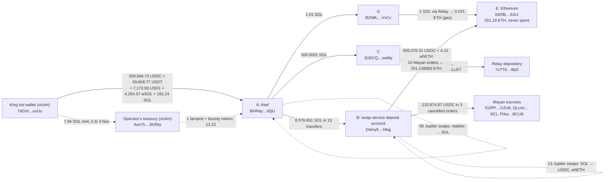
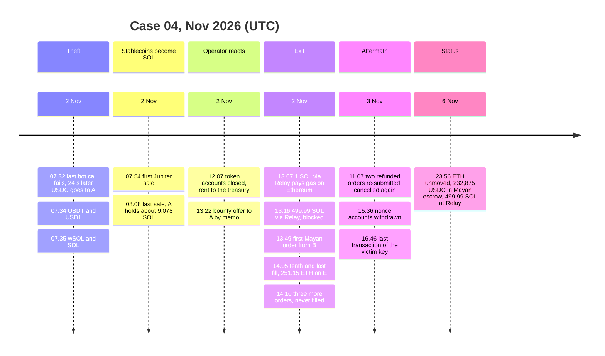

# [DRAFT] Case 04: Solana arbitrage bot drained by its own key ($856k; $280k of it held back by two bridges)

> **Sources.** The incident was published by Onchain Lens on X on 2 Nov 2026 at 18:12 UTC ([post](https://x.com/OnchainLens/status/2117318995460476935)): three addresses and a loss of about $786k. News items repeat that post ([Cointelegraph via TradingView](https://www.tradingview.com/news/cointelegraph:9d2e784a2094b:0-crypto-investigators-flag-suspected-106m-theft-786k-solana-bot-drain/), [TechFlow](https://www.techflowpost.com/en-US/newsletter/142597), [PANews](https://panews.io/articles/01a19ed0-f4b9-72ea-8fb1-6115fd3dbc41)); SlowMist's database lists the loss as $856k. The bot's operator has published nothing off chain; its one on-chain message is quoted below. Bridge mechanics come from [Mayan's Swift page](https://docs.mayan.finance/architecture/swift) and [Refunds page](https://docs.mayan.finance/how-mayan-works/refunds.md) and from [Relay's requests API reference](https://docs.relay.link/references/api/get-requests-v2). As of 6 Nov 2026 I found no public fund-flow analysis with transaction hashes.
>
> **Reproducibility.** Every number in this document is recomputed from raw data (Solana RPC, Ethereum RPC, Blockscout, the Mayan explorer API and the Relay API) by `python cases/04-solana-king-mev-bot-drain/checks.py` (52 checks plus 5 informational readings, IDs `C4-xx` cited inline). Raw responses are in `data/cache/`, pinned by `data/cache/MANIFEST.sha256`, so the checks run offline; a full re-run against live nodes on 7 Nov 2026 at 00:25 UTC gave the same results. Full table: [reports/verification.md](reports/verification.md). Address scoring: [reports/risk.md](reports/risk.md). USD: stablecoins at face value, SOL at $94.33 and ETH at $2,287.81, both implied by the thief's own swaps (C4-11, C4-24). Balances and order statuses are as fetched on 6 Nov 2026, 23:56 UTC.

## TL;DR

On 2 Nov 2026, between 07:32 and 07:35 UTC, the wallet of "King", one of the oldest arbitrage bots on Solana, signed five transfers that moved 436,137 in stablecoins and 4,455.81 SOL, about $856k, to a fresh address.

- The transfers carry the victim's own signature and a client fingerprint that neither the bot nor its operator uses (C4-01, C4-04 to C4-06d). No program bug, no approval: someone else had the key, and used it from a script that swept every balance and even forwarded a poisoning bot's dust three seconds after it landed (C4-39b).
- Within 22 minutes the thief began selling every stablecoin for SOL through Jupiter, 66 swaps in 14 minutes, and so left the only assets an issuer can freeze (C4-09, C4-13, C4-33). Nobody froze anything in that window (C4-34).
- Six hours later the SOL went into a swap service's deposit account, came back as USDC and left for one Ethereum address, `0xf2fbf0292215a597f85409e753a4fe4f191663c1`, through 15 Mayan orders. Ten were filled: 251.146683 ETH, about $575k, sit there untouched (C4-22, C4-23, C4-30).
- Two bridges held funds back. Relay refused a 499.99 SOL deposit as `BLOCKED_WALLET` 5 h 45 min after the theft and still holds the SOL (C4-17 to C4-19). Mayan's drivers stopped filling after 14:05: three orders worth 232,874.67 USDC are cancelled in its records but were never refunded, so that USDC still sits in Mayan escrow accounts on Solana, where Circle can freeze it (C4-27, C4-28).
- The bot's operator noticed within hours. From its treasury wallet it offered the thief a 20 % bounty on chain at 13:22 (C4-43), got no reply (C4-44), then used the same key to dismantle the bot: 2,208 token accounts closed and 2,048 nonce accounts withdrawn, 7.94 SOL of rent swept to the treasury (C4-06b, C4-06c).
- The published figure of $786k left out 69,868.77 USDT; the chain shows $856k (C4-38). The alert's "forwarder" is a program-derived address with no private key: a swap service's deposit account, whose relayer serves 32 such accounts (C4-20, C4-36, C4-42). The lead for a data request is that service, not the address.

## Case card

| | |
|---|---|
| Dates | 2 Nov 2026 07:32 to 07:35 UTC (theft), 07:54 to 08:08 (stablecoins sold), 13:07 to 14:12 (exit to Ethereum), 13:22 (operator's bounty offer), 3 Nov 11:07 (refunded orders re-submitted), 3 Nov 15:36 to 16:46 (operator dismantles the bot) |
| Chains | Solana → Mayan and Relay → Ethereum |
| Assets | USDC, USDT, USD1 (SPL tokens), wrapped SOL and SOL on Solana; ETH on Ethereum |
| Loss | 359,094.73 USDC, 69,868.77 USDT, 7,173.93 USD1, 4,264.57 wSOL and 191.24 SOL: about $856k at $94.33/SOL (C4-02, C4-12) |
| Outcome | Nothing recovered as of 6 Nov 2026. $575k as ETH on an address that has not moved; $233k of USDC in Mayan escrow (freezable by Circle, refundable to the thief); $47k of SOL held by Relay (C4-35) |
| My role | Independent analysis of public data, started from the Onchain Lens post. No contact with the bot's operator, Mayan or Relay |
| Checks | 52 passed, see [reports/verification.md](reports/verification.md) |

## What this analysis adds to the Onchain Lens post

| Their statement | Recomputed from chain | Check |
|---|---|---|
| "drained of ~$786K, including 4.26K $WSOL, 191 $SOL and $366K in stablecoins" | 4,264.57 wSOL and 191.24 SOL are right; the stablecoins were 436,137 (359,094.73 USDC + 69,868.77 USDT + 7,173.93 USD1). The $366k figure is USDC plus USD1 and misses the USDT. Total about $856k | C4-02, C4-38 |
| "Forwarder: Ddmy5…Hkqj" | The address is off the ed25519 curve, so no private key exists for it. It is a program-derived deposit account of a swap service; its relayer has signed for 32 such accounts since 23 Jul 2026 | C4-20, C4-36, C4-42 |
| "funds moved through several Solana wallets before being transferred to Ethereum using Mayan" | 15 Mayan orders to one Ethereum address; 10 filled for 251.146683 ETH; 3 cancelled with 232,874.67 USDC still in escrow; a parallel Relay deposit of 499.99 SOL was blocked | C4-22 to C4-28, C4-17 |
| "possible wallet compromise" | The five transfers are signed by the victim's key with a compute-budget setting that appears in none of the bot's transactions and differs from the operator's own hand-made transaction | C4-01, C4-04 to C4-06d |
| Not in the post | The operator's treasury wallet, its on-chain bounty offer, and the dismantling of the bot afterwards | C4-40 to C4-44, C4-06b |

## Addresses

| Role | Address |
|---|---|
| King arbitrage bot wallet (victim) | `7dGrdJRYtsNR8UYxZ3TnifXGjGc9eRYLq9sELwYpuuUu` |
| King bot program (victim) | `King7ki4SKMBPb3iupnQwTyjsq294jaXsgLmJo8cb7T` |
| Operator's treasury: paid by the bot since 2 Jul 2026, sent the bounty offer (victim) | `Ace7hXUYzheTYG6EAYEYec25Y6SXUfKvauavEGy3KRby` |
| A: thief's address, created by the first theft transfer | `BHRayETPjvgg3BCr9H82V1D6NRwxu5v44JAaVuaod3jU` |
| B: swap-service deposit account used by the thief, program-derived (service) | `Ddmy5oM8xtTs1EBC6eF2SZwQfBreewQpFgtUDm51Hkqj` |
| C: thief's address for the blocked Relay deposit | `3UECQUbsLTAfYYtEf3kzvgpw2F5GTu9YFK9dMyokswMy` |
| G: thief's address for the Relay gas top-up | `B2N8LwcUiXD6dCqdnPkyi1TMJQtroefGVLHjjRWrVvCc` |
| E: thief's Ethereum destination, named in every Mayan and Relay order | `0xf2fbf0292215a597f85409e753a4fe4f191663c1` |
| Mayan Swift escrow accounts holding the cancelled orders' USDC (infrastructure) | `Fj2PPeNbkfS1vagKj9XnwVxKRg2bztLmLqoGXVJrG2U6` (93,996.659573 USDC, token account `2zPJeYCyTrBLSFXZc1j7XcRjiUgyZUWv5Jn2eQazckQf`), `QLcnnbAjX6Db564MARQHG1yq3XPxHVf3hdDSQQYE9Z1` (94,148.525771 USDC, `5xGVVduQQyU8iMpprLAtcrp3XacFErLc2cGVHPxqoMkN`), `Ff4uihAPMdPYuF1DgEzEjRaWnGaNpGjVWvcEAGMgBCU8` (44,729.481555 USDC, `2yb1VSSjV23hAyQ1iPkDeKrd9cwHR12LV91X6qEhpwPT`) |
| Mayan SwiftDest contract on Ethereum (infrastructure) | `0xD78D199f8C402e7B5Cc2abE278dF0412400a3BAe` |
| Relay Solana depository, holds the blocked 499.99 SOL (infrastructure) | `7uTT8Xi5RWXzy7h9XL244GRgEycDYDhLjr3ZyNdXi8pZ` |
| Swap-service relayer, sole signer of B's swaps and orders (infrastructure) | `6XQTpahMTFf1Rq1MtzayMSCi2dr6ZE5YJdJpCZ5DuFTG` |
| Swap-service programs (infrastructure) | `GFRP4yXUjvcQemf2zRJN8w9sPNaDk5PyBUQdPHD1AzLp` (upgrade authority `5aaHPox5ZCfxEzxgtzwbEk2DtqMG3JrnnQbqbPuyev6y`), `5VtQHnhs2pfVEr68qQsbTRwKh4JV5GTu9mBHgHFxpHeQ` |

Two third-party addresses that touched the case and were set aside are listed in "False leads, resolved".

## My role

Independent analysis of public data. The only outside inputs were the three addresses and the loss figure in the Onchain Lens post. Everything else is recomputed from chain data and the two bridges' public APIs. I traced the case with the HopChase tooling I am building for this kind of work; the gaps it showed here are recorded separately and are not part of this case.

## Background: freezable assets, bridge orders and deposit accounts

- **Freezable and non-freezable assets.** USDC, USDT and USD1 on Solana carry a freeze authority: the issuer can freeze any token account holding them (C4-33). SOL and wrapped SOL have no such authority. A thief who turns stablecoins into SOL within minutes takes away the issuers' only lever. That is what happened here, in 66 swaps between 07:54 and 08:08 (C4-09).
- **Mayan Swift.** Mayan's documentation describes Swift as an intent protocol: "The source contract locks the input tokens", drivers "submit offers on Solana based on the output they can deliver on the destination chain", the winning driver pays the user on the destination chain from its own liquidity and is reimbursed when the source funds unlock. Every order has a `deadline64`; "If no driver fills it before that deadline passes, the order is refunded", and a refund is a separate on-chain action with its own relayer fee. The documentation does not say who triggers the refund. On chain, each order's input sits in a program-owned escrow account until a driver claims it or a refund is executed; in this case three refunds were never executed (C4-27, C4-28).
- **Relay.** Relay takes a deposit on the source chain and a solver pays out on the destination chain. Its requests API records each order with a `status` and, on failure, a `failReason`; `BLOCKED_WALLET` is one of the documented reasons. The API does not say what happens to a blocked deposit. In this case it was neither paid out nor refunded (C4-17, C4-18).
- **Deposit-account swap services.** Some Solana swap front-ends give each session a program-derived address to deposit into. A program-derived address lies off the ed25519 curve, so no private key exists for it; the service's program moves the funds by its own signature when the service's relayer submits the transaction. On chain this looks like an address that receives funds and at once swaps and bridges them without ever appearing as a signer (C4-20, C4-42). The service, not the address, saw the client that used it.
- **Durable nonce accounts and token accounts.** A Solana bot keeps hundreds of token accounts (one per token it trades) and durable-nonce accounts (one per transaction it may need to pre-sign). Each holds a rent deposit. Closing them returns the rent to whoever the authority names: a routine clean-up for the owner, and pennies for a thief (C4-06b, C4-06c).

## How it unfolded

Short labels in the diagrams; full addresses are in the Addresses table. The complete graph with every scored address is in [reports/graph.md](reports/graph.md).

### 1. The theft: five transfers in three minutes (2 Nov, 07:32 to 07:35 UTC)

- **Signed by the victim.** All five transactions carry a single signature, the bot wallet's own key (C4-01). Four are `transferChecked` calls that create A's associated token account and move the whole balance of one mint; the fifth is a system transfer of 191.242413486 SOL (C4-02, C4-03). Only the associated-token, token and system programs are called, and no delegate is involved.
- **Not the bot's client, not the operator's.** The five transactions set a compute-unit price of 50,000 and no compute-unit limit. The bot's own transactions, all calls to its program `King7ki4SKMBPb3iupnQwTyjsq294jaXsgLmJo8cb7T`, set no compute budget at all: none of the 100 it signed right before the theft does (C4-04, C4-05). The operator's own hand-made transfer later that day uses a third setting, limit 562 and price 133,333,334 (C4-06d). The thief signed from software neither of them uses.
- **The bot stopped with the theft.** Its last program call, which failed, was at 07:32:26, 24 seconds before the first transfer. None of the 94 transactions after the theft calls the program (C4-06). What the key did afterwards is in "Containment and recovery".

| Time (UTC) | Event | Tx |
|---|---|---|
| 07:32:50 | 359,094.73421 USDC to A (C4-02) | `2sUAaakTAfQ1J1WdbkafEMemG9m96aHqvo887Ajix2i4Z4QoGtinPTh3QdtwGvzcjmHuChr6Mx7CVs7na7xhG65r` |
| 07:34:39 | 69,868.765015 USDT to A | `4AJoXUr3SMVqvXptuZUSPag4bSB8zKfSehL3Bg7bPZqhtGh81SRZ6jXUtbuioWrebXNJYArEM4TveNcYqsKKNDd4` |
| 07:34:50 | 7,173.929438 USD1 to A | `3FskNQ4qbXSBoHgApgXKMqGDxRVsPxFj4u48kFYtYFDjP2QxzwFYroRCfohsAxbREf8F6unpXLDYVkZ7nNmcGRNP` |
| 07:35:06 | 4,264.570828378 wSOL to A | `5qKUfKnMqvs2QxF2vj1pTpJExMfgSd2b65fKnhvF77DmbPfhKgHAPhaGMF5L9nFpJQ61T9kfTrhnZCVJkaK2w78Z` |
| 07:35:16 | 191.242413486 SOL to A | `2tYN1nHbmrRqu8NfrGxKba7y9uxSzoCFfqiSs9JWGL1w6rzG2whWudkPdL9Ti15XmqvYn97LwgVRLVJ11kshj1uh` |

### 2. Stablecoins become SOL (07:54 to 08:08)

- **A did not exist before the theft.** Its oldest signature is the USDC transfer; it had no history and no funding of its own (C4-08).
- **66 Jupiter swaps in 14 minutes.** Starting 21 minutes 58 seconds after the first transfer, A unwrapped the wSOL and sold the USDC in seven lots of 50,000 plus the remainder, then the USDT in 52 lots of 20 (nine seconds apart, eight minutes in all), then in three lots of 20,000 plus the remainder, and the USD1 in one swap (C4-09, C4-09b, C4-13). The 52 small sales read as a mistyped chunk size, 20 for 20,000, noticed and corrected after eight minutes. The stablecoin balances went to zero without a single freeze (C4-34).
- **Price basis.** The seven 50,000 USDC sales returned 3,710.28 SOL, which puts SOL at $94.33 and the theft at about $856k (C4-11, C4-12). A gained about 8,886 SOL from the swaps and ended the phase with about 9,078 SOL including the 191 it was sent (C4-10).

### 3. Exit to Ethereum through Relay and Mayan (13:07 to 14:12)

- **Gas first.** Five hours after the last swap A sent 1.01 SOL to G, which deposited 1 SOL with Relay; Relay paid 0.040953 ETH to E on Ethereum at 13:07, E's first transaction (C4-16). E is a fresh externally owned account.
- **Relay said no.** At 13:14 A sent 500.0001 SOL to C, which deposited 499.99 SOL with Relay for 20.47 ETH to E. Relay's record ends in `failure`, reason `BLOCKED_WALLET`, no payout and no refund; the SOL sits in Relay's Solana depository and C keeps 0.01 SOL (C4-17, C4-18). The block came 5 h 45 min after the theft (C4-19). The thief did not try Relay again.
- **A deposit account instead of a wallet.** From 13:49 A sent 8,576.651 SOL to B in 13 transfers (1, 100, 500, 500, 500, 500, 1,000 × 6, 475.651), each followed within seconds by a swap and a Mayan order (C4-14). B never signed anything: all 44 of its transactions carry one signature, from A (the hand-offs), from the service relayer `6XQTpahMTFf1Rq1MtzayMSCi2dr6ZE5YJdJpCZ5DuFTG` (13 Jupiter swaps and 15 Mayan orders), from Mayan's refund relayer or from a dust sender (C4-20). B is a program-derived address with no private key (C4-42), and the relayer has served 32 such accounts since 23 Jul 2026 (C4-36).
- **Thirteen swaps back into stablecoins.** B turned the 8,576.65 SOL into 797,951.48 USDC and 4.15 wrapped ETH (C4-21). The SOL had been bought with stablecoins six hours earlier: the round trip kept the funds out of the issuers' reach for those six hours, at the cost of the swap fees.
- **Fifteen Mayan orders, one destination.** Every order names E as the destination and ETH as the output: ten filled, two refunded, three cancelled (C4-22). Ten were filled between 13:49 and 14:05: 565,076.3112 USDC and 4.1527 wETH in, 251.146683 ETH out, paid to E by Mayan's SwiftDest contract in ten internal transfers (C4-23, C4-25). The USDC orders price ETH at $2,287.81 (C4-24).
- **Then the fills stopped.** The orders of 14:10 (94,148.77 USDC) and 14:12 (44,729.74 USDC) expired unfilled and were refunded to B on 3 Nov at 11:07, less relayer fees (C4-26). The order of 14:11 (93,996.66 USDC) was cancelled and never refunded. Two seconds and one second after the refunds landed, the service relayer placed each refunded amount in a new order to E; both were cancelled again (C4-27, C4-27b). A delay of one or two seconds is the service's automation at work; a refund to B goes straight back into an order. The USDC of those three orders, 232,874.666899 USDC, is still in the three escrow accounts, token accounts `initialized`, not frozen (C4-28). Why the drivers stopped bidding is not on chain (see "Confidence assessment").

| Time (UTC) | Event | Tx |
|---|---|---|
| 13:07:39 | G: 1 SOL to Relay, paid as 0.040953 ETH to E (C4-16) | `4GDQEULcjo7oLBcdyvXHwAbgnZRMGsQGZp9mM9ND6ao1XuwU36v4sbSfGHXF75E8kqnvDkGv5n3zRAAkPi8rRCPE` |
| 13:16:11 | C: 499.99 SOL to Relay, blocked (C4-17) | `3ZhURdE35CPyJ5A7gVg46VAG1zA6Znay5yf3n3iPwYCTxwX3yTFaQNbgAeQ19J2aENR8pG86RD2RMBdBuiK4AcmD` |
| 13:49:05 | B: first Mayan order, 0.041 whETH (C4-22) | `218g1mvsjJqn2wWFZBm59HhhoSr7SticchLaxbK4v2ktKAdVPHZnUjhVdHvwZDpD4pWnPeLpecQGAx6qp4Yo7xbe` |
| 14:03:15 | B: tenth and last filled order, 94,185.785685 USDC (C4-23) | `3Br3qrfqxJgcE6w6Yp7kPfL8mrk6VUBDdGzmu1UGHU7h2Q8vvAz5q6AJSQEKcxs1xyCrfQ6xPAmxn82beFWistZa` |
| 14:11:39 | B: 93,996.659573 USDC order, cancelled, never refunded (C4-27) | `3LxvF27HfjF9k2LguAg3pJdekeHpksefmWMdoyWfCoxGZZNoqHDztqo8wgSaX7oW7gcBodSukLE6iFWoriE56WPN` |
| 3 Nov 11:07:25 | B: re-submission of 94,148.525771 USDC, cancelled (C4-27) | `4N3Rb1dUT3h8wsK6jqZzfP6m9U21PuU8owvnbK6cQo2KM1Q2bLevijUZWJiLuNTb6vCkABTEVx28X1GeYEMLNh43` |
| 3 Nov 11:07:32 | B: re-submission of 44,729.481555 USDC, cancelled (C4-27) | `3ahFVWggpWejdTnnVbbKsLPczCHvbZafdtmhswhRyUjKMqXR89UqZkCSrZpw4gAX1Ar8Rb2o8smnhnrfEAbDyeLA` |

## False leads, resolved

**1. The 0.001111 USDC and USDT dust "from A" to the victim.** At 07:34:54, after three of the five transfers, `BHRaXMvvhobJPpFm9x28M5vzWbcGwRTDjW76XH4fY3jU`, which shares the first four and last three characters with A, sent 0.001111 USDC to the victim, and 0.001111 USDT at 07:36 (C4-39). It came after the theft had started, so it is not the poisoning that caused it; it is a bot hoping the victim's next copy-paste picks the look-alike. The same bot worked the other side: `7dGrPwHjdeAEcU2VKjFj7GhdoSnb3JqfRxWLkfjGuuUu`, a look-alike of the victim, sent A the same dust amounts in the same minutes with the same client fingerprint (C4-39c), and A went on to receive 18 such dust transfers from look-alikes of B, C, G and the treasury after each of its own transfers (C4-39d). Three seconds after the USDC dust landed on the victim, the victim's key forwarded it to the real A with the theft's fingerprint. That is the drain script's sweep loop: it ran between the USD1 and the wSOL transfers, and the USDT dust that landed after the final SOL transfer was never forwarded (C4-39b). The risk model records both look-alikes as resolved third parties.

**2. The 1 wei transfer to E on 3 Nov.** `0x7c0b22d3642f335aB0F08C5FD0a38Ff6262D03d7` sent 1 wei to E at 09:19 on 3 Nov (C4-32). The calldata is a short begging message asking for money; the sender has hundreds of such zero-value transfers to unrelated addresses. Not the thief, not the operator.

**3. The relayer as "the attacker".** `6XQTpahM…DuFTG` signed every swap and bridge order of B and pays the fees, so it looks like the thief's hot wallet. It has done the same for 31 other deposit accounts since July, with amounts from a few dollars to a few thousand (C4-36). It is the service's relayer and is classed as infrastructure.

**4. The post-theft activity of the victim key as "the thief still inside".** After the theft the key signed 88 more transactions, closing 2,208 token accounts and withdrawing 2,048 nonce accounts, with all the rent going to `Ace7hXUYzheTYG6EAYEYec25Y6SXUfKvauavEGy3KRby` (C4-06b, C4-06c). Four of those transactions, at 12:38, are signed by both keys at once, the treasury paying the fee and the victim's key authorising the transfers (C4-06e). That address has received the bot's payouts since 2 Jul 2026 and signs for itself (C4-40, C4-41), and at 13:22 it sent the thief a bounty offer by memo (C4-43). It is the operator's treasury, and the clean-up is the operator's. My first reading of the history had the bot "running for 33 hours after the theft"; it was not.

**5. Three frozen token accounts on the victim.** The victim wallet holds three accounts in the `frozen` state. They hold spam tokens with their own freeze authority, not any of the stolen mints (C4-07). No issuer froze anything in this case.

## Containment and recovery

- **12:07 to 12:09, 2 Nov:** the operator, using the same key, closes the bot's 2,208 token accounts; the rent goes to the treasury (C4-06b, C4-06c). 4 h 35 min after the theft, the first visible sign that the operator knows. At 12:38 four more clean-up transactions carry the treasury's signature next to the victim's (C4-06e).
- **13:22:50, 2 Nov:** the treasury sends A one lamport with a memo: return 80 % within 48 hours, keep 20 % as a white-hat bounty, reply with a signed message (C4-43; the text is in [reports/verification.md](reports/verification.md), C4-43b). A never replied and never sent anything back; it had handed everything on by 14:12 (C4-44).
- **13:18, 2 Nov:** Relay marks C's deposit `BLOCKED_WALLET` and keeps 499.99 SOL (C4-17, C4-19). The first intervention by a third party, 5 h 45 min after the theft.
- **14:05 onward, 2 Nov:** Mayan's drivers stop filling B's orders; 232,874.67 USDC is left in escrow (C4-27, C4-28). Whether that was a decision or a coincidence is not public.
- **3 Nov 15:36 to 16:46:** the operator withdraws the bot's 2,048 nonce accounts to the treasury and the key goes quiet (C4-06b). The bot's program was last called at 07:32:26 on 2 Nov (C4-06).
- **Freeze window on the stablecoins:** 21 min 58 s on A, from 07:32:50 to 07:54:48, with a freeze authority on all three mints. Not used (C4-13, C4-33, C4-34).
- **Freeze window still open:** the three Mayan escrow token accounts, 232,874.666899 USDC, since 14:11 on 2 Nov. Not used as of 6 Nov 2026 (C4-28).
- **Nothing recovered.** The 251.19 ETH on E has not moved (C4-30).

Where the money is, as of 6 Nov 2026, 23:56 UTC:

| Where | Amount | USD | Can it be stopped |
|---|---:|---:|---|
| E on Ethereum | 251.187636 ETH | $574,576 | No issuer; only an exchange, if it is ever deposited. E is on neither Circle's nor Tether's list, which do not apply to ETH anyway (C4-30, C4-31) |
| Mayan Swift escrows on Solana | 232,874.666899 USDC | $232,875 | Yes: Circle can freeze the three token accounts. Mayan can also refund them to B, which would put them back in the thief's hands (C4-28) |
| Relay Solana depository | 499.99 SOL | $47,164 | Held by Relay after its own block; a request to Relay with a case number (C4-18) |
| A and B | 0.00077 SOL, 0.0002 USDC, 0.00065 SOL | $0 | Empty (C4-15, C4-29) |

Together $854,615 of the $856,454 taken; the difference is swap fees and slippage (C4-35).

## Risk scoring

`python -m risk.score cases/04-solana-king-mev-bot-drain` scores every address in `graph.json` with the rules in `risk/model.py`. Full table with reasons: [reports/risk.md](reports/risk.md). The whole graph, coloured by band: [reports/graph.md](reports/graph.md).

| Score | Band | Address | Main reasons |
|---:|---|---|---|
| 100 | SEVERE | `BHRayETPjvgg3BCr9H82V1D6NRwxu5v44JAaVuaod3jU` | R1 seed: received the five theft transfers, sold the stablecoins, handed the SOL on |
| 100 | SEVERE | `0xf2fbf0292215a597f85409e753a4fe4f191663c1` | R1 seed: destination of all 15 Mayan and both Relay orders |
| 100 | SEVERE | `3UECQUbsLTAfYYtEf3kzvgpw2F5GTu9YFK9dMyokswMy` | R3 received $47k from the seed, R6 single use, R6b pass-through, R7 fresh |
| 100 | SEVERE | `B2N8LwcUiXD6dCqdnPkyi1TMJQtroefGVLHjjRWrVvCc` | R3 received $95 from the seed, R4 funded the seed E, R6, R6b, R7 |
| 100 | EXPOSURE-SEVERE | `Ddmy5oM8xtTs1EBC6eF2SZwQfBreewQpFgtUDm51Hkqj` | service deposit account: R3 received $809k from the seed, R4 funded the seed E, R7 fresh; action: data request to the service operator |
| 35 | RESOLVED | `7dGrdJRYtsNR8UYxZ3TnifXGjGc9eRYLq9sELwYpuuUu` | victim: R4 points shown, band overridden |
| 35 | RESOLVED | `Ace7hXUYzheTYG6EAYEYec25Y6SXUfKvauavEGy3KRby` | operator's treasury: R4 points for the memo transfer shown, band overridden |
| 20 | RESOLVED | `BHRaXMvvhobJPpFm9x28M5vzWbcGwRTDjW76XH4fY3jU` | look-alike dust sender, third party |
| 0 | N/A | Mayan escrows, Relay depository, SwiftDest, service relayer | infrastructure, never scored as owner |

## Confidence assessment

| Level | Statement |
|---|---|
| **Proven (on-chain)** | The five transfers were signed by the victim's key and moved 359,094.73 USDC, 69,868.77 USDT, 7,173.93 USD1, 4,264.57 wSOL and 191.24 SOL to A (C4-01 to C4-03). A sold all of it for SOL between 07:54 and 08:08 (C4-09). 8,576.651 SOL went to B, 500 to C, 1.01 to G (C4-14). Ten Mayan orders from B paid 251.146683 ETH to E (C4-23, C4-25); Relay paid E's gas from G's 1 SOL (C4-16). 232,874.67 USDC of B's orders are in three Mayan escrow accounts and 499.99 SOL of C's deposit is with Relay (C4-18, C4-28). E holds 251.19 ETH and has never spent (C4-30). B is a program-derived address (C4-42). The treasury has been paid by the victim key since 2 Jul and sent the bounty memo (C4-40, C4-43). After the theft the victim's key and the treasury's key signed the same four transactions (C4-06e): whoever runs the treasury held the victim's key from 12:38 on 2 Nov. The drain forwarded a dust deposit three seconds after it landed and stopped after the SOL transfer (C4-39b): it was scripted. |
| **Strong** | The key was used from software that is neither the bot's nor the operator's: the theft's compute-budget fingerprint appears in none of the bot's transactions and differs from the operator's hand-made transfer (C4-04 to C4-06d), and the transfers are plain token transfers with no program or delegate (C4-03). The post-theft clean-up is the operator's: the treasury that co-signed it has received the bot's payouts for four months and itself asked the thief for the funds back (C4-06b, C4-06e, C4-40, C4-43). |
| **Moderate** | Mayan's drivers stopped filling B's orders because the destination or the source had been flagged: Relay blocked the same destination an hour earlier, the first ten orders filled within seconds and the next three never got a bid. A driver outage at exactly 14:05 would explain it as well. |
| **Suspicion** | After the scripted drain, a person took over: the 52 sales of 20 USDT look like a mistyped amount corrected after eight minutes (C4-09b), and the 1 SOL and 1.01 SOL test transfers (to B, to G) show someone feeling out each tool before committing the balance. An individual running their own scripts rather than a drainer kit. Nothing on chain confirms it. |
| **Not established** | How the key was obtained (the bot's server, its hosting, a leaked keypair file); who operates E; which service runs B and whether it keeps session records that identify its user. |

## Limitations

- The victim's history was read through one page of 1,000 signatures (2 Nov 06:59 to 3 Nov 16:46). The client-fingerprint comparison uses the 100 transactions the bot signed right before the theft, all failed or successful calls to its program; a longer baseline would make the "Strong" call stronger but cannot make it "Proven".
- The treasury's history was read through one page of 252 signatures, which reaches back to its first transaction on 2 Jul 2026. Its own outflows (to four addresses between July and November) are the operator's business and were not traced.
- Mayan's and Relay's order records come from their public APIs, not from chain data. The amounts and hashes in them were checked against the chain (C4-25, C4-16), but the statuses (`ORDER_CANCELED`, `BLOCKED_WALLET`) are the operators' own words and can change. Relay's v2 API is documented as deprecated from 24 Nov 2026.
- The swap service behind B is identified by its programs and relayer, not by name. I did not find a public name for program `GFRP4yXUjvcQemf2zRJN8w9sPNaDk5PyBUQdPHD1AzLp`.
- USD figures use the thief's own swap rates at the time. A market oracle would differ by a few percent.

## Open leads

1. **Freeze the escrow USDC.** Circle can freeze token accounts `2zPJeYCyTrBLSFXZc1j7XcRjiUgyZUWv5Jn2eQazckQf`, `5xGVVduQQyU8iMpprLAtcrp3XacFErLc2cGVHPxqoMkN` and `2yb1VSSjV23hAyQ1iPkDeKrd9cwHR12LV91X6qEhpwPT` (232,874.67 USDC). Mayan can refund them to B at any time, and a refund is re-ordered to E by the service's automation within seconds, as the two refunds of 3 Nov were (C4-27b). Whoever represents the operator should ask Circle to freeze and Mayan not to refund on the same day.
2. **Relay holds 499.99 SOL.** Relay's own record says the deposit was blocked and not refunded. A request from the operator with a police case number is the route to that SOL.
3. **Watch E.** 251.19 ETH on an address with no outgoing transaction. The first outgoing transaction decides whether an exchange can act; `checks.py` re-reads the balance and nonce on every run (C4-30).
4. **The swap service's logs.** The service's relayer signed every transaction of B and its program derived B; the service saw the client that created the session and submitted the orders. The upgrade authority of its program, `5aaHPox5ZCfxEzxgtzwbEk2DtqMG3JrnnQbqbPuyev6y`, is the on-chain handle for a data request.
5. **The bot's own host.** The key was used from unfamiliar software while the bot's program was never called again (C4-05, C4-06). The operator's host logs for 2 Nov 07:30 to 07:36 UTC are the place to look for how the key left the machine.

## Lessons learned

- **For bot operators:** a hot key that holds $856k and runs 24/7 on a server is a single point of failure. Keep the trading key's balance to working capital and sweep profits to a key that never touches the server, as this operator already did weekly. Alert on any transfer your software did not build: the compute-budget fingerprint would have flagged this in seconds, and 22 minutes were available before the stablecoins became SOL.
- **For stablecoin issuers and their monitoring partners:** 22 minutes is a realistic window for a freeze when the alert comes from the victim's own monitoring, and no window at all when it comes from a public post eleven hours later. The escrow accounts of a cancelled bridge order are a freeze target that stays open for days.
- **For bridges:** both refusals here held funds rather than refunding them, which is the right outcome for a victim. Publishing what happens to blocked deposits, and to whom they are released, would let victims act on it.
- **For investigators:** check who signed before calling an address a wallet. Here the "forwarder" was a program-derived deposit account and the signer served 31 other users; and the "bot still running after the theft" was the operator closing accounts, which a look at the signer and the destination of the rent settles in one query. When a thief sells stablecoins for the native coin within minutes, read it as a freeze-avoidance step and look for the moment it buys stablecoins back: that is where the bridge records are.

## Appendix: key references

Solana hashes open on [Solscan](https://solscan.io) or [Solana FM](https://solana.fm); Ethereum hashes on [Etherscan](https://etherscan.io) or [Blockscout](https://eth.blockscout.com); Mayan orders on [explorer.mayan.finance](https://explorer.mayan.finance); Relay requests at `https://api.relay.link/requests/v2?hash=<tx>`. The complete evidence index is in [reports/verification.md](reports/verification.md).

| Event | Chain | Reference |
|---|---|---|
| Theft 1: 359,094.73421 USDC to A | Solana | `2sUAaakTAfQ1J1WdbkafEMemG9m96aHqvo887Ajix2i4Z4QoGtinPTh3QdtwGvzcjmHuChr6Mx7CVs7na7xhG65r` |
| Theft 2: 69,868.765015 USDT to A | Solana | `4AJoXUr3SMVqvXptuZUSPag4bSB8zKfSehL3Bg7bPZqhtGh81SRZ6jXUtbuioWrebXNJYArEM4TveNcYqsKKNDd4` |
| Theft 3: 7,173.929438 USD1 to A | Solana | `3FskNQ4qbXSBoHgApgXKMqGDxRVsPxFj4u48kFYtYFDjP2QxzwFYroRCfohsAxbREf8F6unpXLDYVkZ7nNmcGRNP` |
| Theft 4: 4,264.570828378 wSOL to A | Solana | `5qKUfKnMqvs2QxF2vj1pTpJExMfgSd2b65fKnhvF77DmbPfhKgHAPhaGMF5L9nFpJQ61T9kfTrhnZCVJkaK2w78Z` |
| Theft 5: 191.242413486 SOL to A | Solana | `2tYN1nHbmrRqu8NfrGxKba7y9uxSzoCFfqiSs9JWGL1w6rzG2whWudkPdL9Ti15XmqvYn97LwgVRLVJ11kshj1uh` |
| Operator's bounty offer to A (memo) | Solana | `45N4TzDwdkihMMS3d2qU7G29HY8NYyHeQuvLa6rHSmaRqjD2eChQmpFFnieAon1ZXR1rAjYsVT4dKEtK4JFNZG5q` |
| Operator's hand-made transfer, third fingerprint | Solana | `3CTQRjxLmMwhP1uN3W7WvfJLBVKNZcbho9Ne8q1S6UMTCMM3gU3MHKpoRSWKSXyMDnfZZzSgNhJ6znAoppYqd7Dw` |
| First of the operator's account closures | Solana | `3V6BmAPnFMrfLcjj1R6f9mjkzP5qLcTgxkrJovmwhySrRri2MwWrcqf5AGun4eFXFW4fDTEZv41BJy5AvET5M8Cq` |
| Relay gas order, G to E | Solana → Ethereum | `4GDQEULcjo7oLBcdyvXHwAbgnZRMGsQGZp9mM9ND6ao1XuwU36v4sbSfGHXF75E8kqnvDkGv5n3zRAAkPi8rRCPE` → `0x32c633f0a03510cd3d31f5ac4d27a18371132b759402df12001f69944a727391` |
| Relay blocked order, C | Solana | `3ZhURdE35CPyJ5A7gVg46VAG1zA6Znay5yf3n3iPwYCTxwX3yTFaQNbgAeQ19J2aENR8pG86RD2RMBdBuiK4AcmD` (request `0x179362537090e11fafbc7901bc72d96675aac24afed8c3acf11702299124f0ed`) |
| First Mayan fill on Ethereum | Ethereum | `0xccc944aa0a86db5d513f65067f54028243fa06089ab95195560f71f1101da8c2` |
| Last Mayan fill on Ethereum (41.139994 ETH) | Ethereum | `0xe88fd26bcdb573308dcb9314b894afbb06789a3e129024792dced993a05430d3` |
| Mayan order left in escrow, 93,996.659573 USDC | Solana | `3LxvF27HfjF9k2LguAg3pJdekeHpksefmWMdoyWfCoxGZZNoqHDztqo8wgSaX7oW7gcBodSukLE6iFWoriE56WPN` |
| Mayan refund of 94,148.525771 USDC to B | Solana | `YTcsboppzhewGQjLSwmJ8XpbkHCK68fSuWTVZQCPF5rBPkC6pQECMxMkGBEUMYqgz6XBQ2eqcvRbrCs9sYye7Tf` |
| Mayan refund of 44,729.481555 USDC to B | Solana | `3FTataS3m4B2CtVXRWk8fii8SwRAHvZ2khybU4eSGrnQvKjWqydkrtaky6HaVW6ozmp6RzxGmF1uKSaWaS6Wjq5V` |
| Re-submitted orders, cancelled, in escrow | Solana | `4N3Rb1dUT3h8wsK6jqZzfP6m9U21PuU8owvnbK6cQo2KM1Q2bLevijUZWJiLuNTb6vCkABTEVx28X1GeYEMLNh43`, `3ahFVWggpWejdTnnVbbKsLPczCHvbZafdtmhswhRyUjKMqXR89UqZkCSrZpw4gAX1Ar8Rb2o8smnhnrfEAbDyeLA` |
| Look-alike dust to the victim | Solana | `5DcAJvZhLVYrX7q2CF8zFLzjuaaq7EP8qrByqc6BHqJBjnh4FPwc7bfcT7qiWLEAio4FVfeUMEaeAUinS7EBsfmg` |
