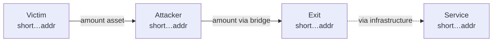
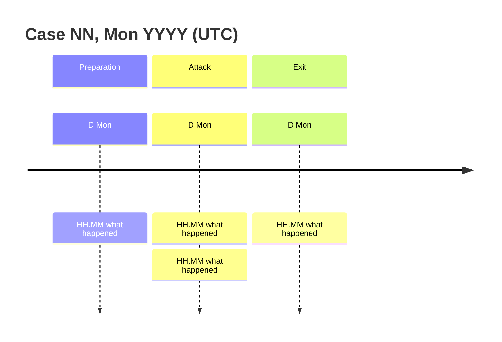

# Case NN: <what happened, in one line> (<the one number or mechanism that makes it notable>)

<!--
Copy this file to cases/NN-slug/README.md and replace every <placeholder>.
Rules for wording, dates, amounts, addresses and diagrams: docs/REPORT_STYLE.md.
Structure is checked by `python -m tools.casedoc lint` (part of `python verify.py`):
section names and order, the fixed tables, the two diagrams at the top of
"How it unfolded", links to the generated reports, and every cited check ID.
Sections marked (optional) may be deleted; all others are required and stay in this order.
Delete these comments when the case is written.
-->

> **Sources.** <Where the outside facts come from: post-mortems, protocol docs, press. Link each. For a client case write "Anonymization." instead and say which off-chain identifiers are replaced with labels.>
>
> **Reproducibility.** Every number in this document is recomputed from raw chain data by `python cases/NN-slug/checks.py` (<N> checks, IDs `CN-xx` cited inline). Raw responses are in `data/cache/`, pinned by `data/cache/MANIFEST.sha256`, so the checks run offline. Full table: [reports/verification.md](reports/verification.md). Address scoring: [reports/risk.md](reports/risk.md). <Prices used for USD figures, and any data that could not be fetched.>

## TL;DR

<One sentence: date, victim, amount, mechanism.>

- <What happened, with the key number and its check ID (CN-xx).>
- <Where the money went.>
- <What was contained or recovered, or why nothing was.>
- <The one finding that is new or that changed the picture.>

## Case card

| | |
|---|---|
| Dates | <D Mon YYYY (phase), D Mon YYYY (phase)> |
| Chains | <Chain → Chain → Chain> |
| Assets | <asset, standard, contract or denom> |
| Loss | <amount and USD, with the price basis> |
| Outcome | <contained / recovered / net loss, or "nothing recovered as of D Mon YYYY"> |
| My role | <lead investigator / community investigator / independent analysis> |
| Checks | <N> passed, see [reports/verification.md](reports/verification.md) |

## What this analysis adds (optional)

<!-- Only when someone else (the victim, a security firm) has published an account. Compare their statements with what the chain shows. -->

| Their statement | Recomputed from chain | Check |
|---|---|---|
| <quote or paraphrase> | <what the data shows> | CN-xx |

## Addresses

| Role | Address |
|---|---|
| Attacker (<chain>) | `<full address>` |
| Attacker (<chain>), same key | `<full address>` |
| <Victim contract or wallet> (victim) | `<full address>` |
| <Bridge, vault or adapter> (infrastructure) | `<full address>` |

## My role

<What I did, what others did, and what in this repository is my own follow-up work. One short paragraph or a short list.>

## Objectives (optional)

1. <What the investigation had to answer.>

## Background (optional)

<!-- Name it "Background: <topic>". Only what a reader needs to follow the mechanism. -->

- <How the protocol feature works that the attack used.>

## Methodology and tools (optional)

- <Data sources, decoders, heuristics, and which `tools/` module implements each.>

## How it unfolded

<!-- Two diagrams first, then the numbered steps. Short labels in diagrams; full addresses are in the Addresses table. -->

Short labels in the diagrams; full addresses are in the Addresses table. The complete graph with every scored address is in [reports/graph.md](reports/graph.md).

### 1. <Phase name> (<D Mon, HH:MM to HH:MM UTC>)

- **<Lead-in in bold.>** <Facts, each with its tx hash or check ID (CN-xx).>

| Time (UTC) | Event | Tx |
|---|---|---|
| HH:MM:SS | <event> (CN-xx) | `<full hash>` |

### 2. <Phase name> (<date>)

- <...>

## False leads, resolved

<!-- Every lead that looked real and was not. If there were none, say so in one sentence and say what was checked. -->

**1. <What it looked like.>** <Why it looked that way, what disproved it, and how the risk model records it.>

## Containment and recovery

- **<Time, D Mon>:** <action, by whom>.
- **Freeze window:** <how long the funds sat on a freezable address, and whether it was used>.

## Risk scoring

`python -m risk.score cases/NN-slug` scores every address in `graph.json` with the rules in `risk/model.py`. Full table with reasons: [reports/risk.md](reports/risk.md). The whole graph, coloured by band: [reports/graph.md](reports/graph.md).

| Score | Band | Address | Main reasons |
|---:|---|---|---|
| 100 | SEVERE | `<address>` | R1 seed: <reason> |
| 0 | N/A | <infrastructure> | infrastructure, never scored as owner |

## Confidence assessment

| Level | Statement |
|---|---|
| **Proven (on-chain)** | <Facts that follow from chain data alone, each backed by a check.> |
| **Strong** | <Several independent indicators agree; no contrary evidence.> |
| **Moderate** | <One indicator, or a behavioural pattern without a label.> |
| **Suspicion** | <A hypothesis worth recording; say what would confirm it.> |
| **Not established** | <What the data cannot show.> |

## Limitations

- <Data that was missing, pruned or encrypted, and what that means for the conclusions.>

## Open leads

1. **<Lead.>** <Who can act on it and what to ask for.>

## Lessons learned

- **For <protocol teams / investigators / validators>:** <one lesson per bullet>.

## Appendix: key references

<Explorers that open these hashes. The complete evidence index is in [reports/verification.md](reports/verification.md).>

| Event | Chain | Reference |
|---|---|---|
| <event> | <chain> | `<full hash>` |
